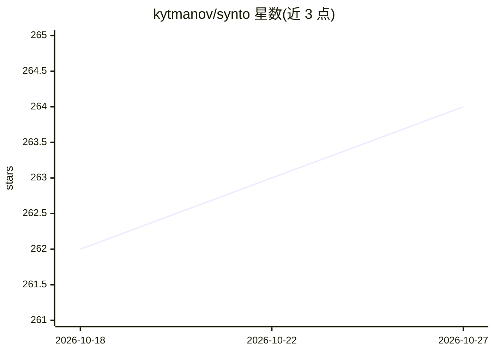

# kytmanov/synto

⭐ 264 · Python · MIT · 推送 2026-10-08 · [GitHub](https://github.com/kytmanov/synto) · 个人维护

**把 Markdown 笔记经本地 LLM 编译成互链 Obsidian wiki 的工具**

面向个人知识管理用户的本地流水线：读取 raw/ 目录中的 Markdown 笔记，用本地 LLM（两级模型：4B 做概念抽取、14B+ 写文章）为每个概念生成互链 wiki 文章，并导出可供 Claude、Cursor 等 agent 使用的知识包（含 MCP 服务）。机制上提供增量编译、拒绝反馈回路、置信度阈值、三态生命周期（draft→verified→published）、SHA-256 手改保护、基于 entity_id 的概念别名/同形词/义项管理，查询不依赖嵌入或向量库。100% 本地运行。

## 筛选速览

| 维度 | 判定 | 备注 |
|---|---|---|
| AI 角色 | `ai-native` | 本体是模型或模型工具 |
| 许可风险 | `permissive` | MIT |
| 部署形态 | `library` | 以包/库形式分发 |
| 模型依赖 | local-ok | 支持本地模型 |
| 硬件要求 | — | 无带数字的原话,不猜 |
| 安装摩擦 | `low` | 无编译、无系统依赖或容器化 |
| 成熟度 | — | 结构信号不足 |

## 能力要点

- 两级 LLM 流水线：小模型抽概念、大模型写文章，消费级硬件可跑
- 增量编译 + 拒绝反馈注入 prompt + 置信度阈值的三态审校流程
- 无嵌入、无向量库的 synto query 与 INDEX.json 路由
- 概念以稳定 entity_id 标识，支持别名/同形词/拆分/合并的策展命令

## 适用场景

- 把教材、讲义、论文笔记整理成可增长的互链 wiki 备查
- 为 Claude/Cursor 等 agent 提供基于自己资料的知识包上下文
- 研究笔记长期积累为带引用与关系的本地知识库

## 场景标签

`知识库管理` · 领域:知识与检索

## 证据(README 行号)

> L16: You drop Markdown notes in a folder. Synto reads them with a local LLM, extracts the concepts they contain, and wri
> L18: After setup (~5 minutes) you have: a structured wiki built from your notes, a queryable knowledge base that works w
> L51: **Why two LLM tiers?** Analysis is pattern-matching — a 4B model running locally can extract "this note is about Qu

## 星数曲线

2026-10-18 262 → 2026-10-27 264（+2）

---
*卡片 v1 · prompt 1.4 · 生成 2026-10-22 · 置信度 high · 依据 README sha `9ba9be75f820` · [字段定义](../../DATASET.md)*
