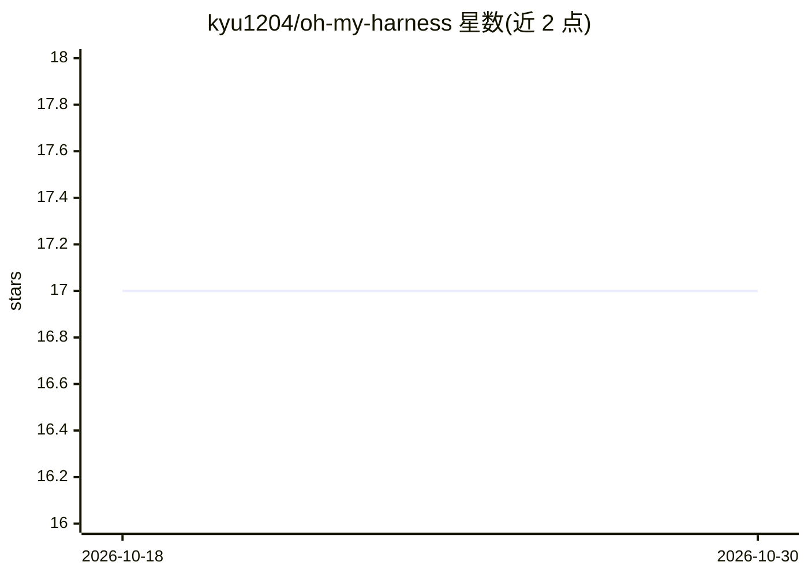

# kyu1204/oh-my-harness

⭐ 17 · TypeScript · MIT · 推送 2026-10-10 · [GitHub](https://github.com/kyu1204/oh-my-harness) · [官网](https://www.npmjs.com/package/oh-my-harness) · 个人维护

**从一句自然语言生成 AI 编码 agent 强制护栏的工具**

面向使用 Claude Code、Codex、Pi 等 AI 编码 agent 的开发者的 CLI 工具：一条 omh init 命令从项目描述生成 harness.yaml、CLAUDE.md、hooks 与设置，通过 PreToolUse 钩子实际阻断危险命令、违规提交、TDD 违例等行为。规则选择可走离线确定性预设（minimal/safe/strict），也可用 TypeSafe 的 Jev 模型或任意 LLM 提供商（含本地 Ollama）；事件记录到 events.jsonl，omh stats/explain 可查。另含自主循环引擎与 25+ 可复用 catalog blocks。需 Node.js>=20，npx 零安装运行。

## 筛选速览

| 维度 | 判定 | 备注 |
|---|---|---|
| AI 角色 | `ai-ecosystem` | LLM/agent 周边工具 |
| 许可风险 | `permissive` | MIT |
| 部署形态 | `library` | 以包/库形式分发 |
| 模型依赖 | local-ok | 支持本地模型 |
| 硬件要求 | — | 无带数字的原话,不猜 |
| 安装摩擦 | `low` | 无编译、无系统依赖或容器化 |
| 成熟度 | `idea` | |

## 能力要点

- 从单个 harness.yaml 生成并同步 markdown 与强制 hooks（omh sync --check 检测漂移）
- 25+ 参数化 catalog blocks：危险命令、TDD、分支保护、secret 文件等守卫
- 规则选择三通道：Jev 模型 / 任意 LLM 提供商 / 离线确定性预设
- 自主循环引擎：按 WORKPLAN.md 在隔离 git worktree 中逐单执行

## 适用场景

- 让 AI 编码 agent 的危险命令与违规提交被硬阻断而非仅提示
- 把 TDD、lint、typecheck 等规范变成 agent 不可绕过的钩子
- 审计 agent 尝试了什么操作、被什么规则拦截

## 场景标签

 · 领域:开发者工具/AI agent 治理

## 证据(README 行号)

> L5: One command turns "TDD enforced, block dangerous commands" into hooks that actually **block** your AI coding agent —
> L36: Because agents read instructions and then forget them halfway through a long session. A rule in a markdown file is 
> L160: omh init "your project description"      # Jev with TYPESAFE_API_KEY, else an LLM provider, else the "safe" preset

## 星数曲线

2026-10-18 17 → 2026-10-30 17（+0）

---
*卡片 v1 · prompt 1.4 · 生成 2026-10-29 · 置信度 high · 依据 README sha `b3c86befebd6` · [字段定义](../../DATASET.md)*
