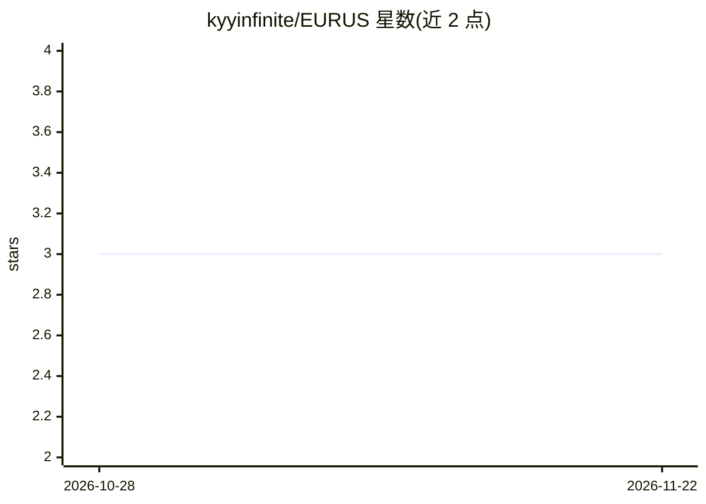

# kyyinfinite/EURUS

⭐ 3 · Python · MIT · 推送 2026-11-09 · [GitHub](https://github.com/kyyinfinite/EURUS) · 个人维护

**终端中的 provider 无关自主 AI 编码代理运行时**

异步 Python 代理运行时，将语言模型接入工具与可复用工作流：代理规划任务、调用工具、检查结果并报告。运行经 AgentEngine 边界持久化到 SQLite，含检查点、审批与预算；变更类工具需审批，无审批者则拒绝。提供 shell 执行、文件编辑、补丁生成、验证、持久记忆、技能学习、MCP 客户端与服务端、浏览器自动化及 Office 文档多代理生产。面向 Termux 与小型 VPS 设计，核心无需 Docker 或原生编译器。自述为 beta 软件，行为可能变更。

## 筛选速览

| 维度 | 判定 | 备注 |
|---|---|---|
| AI 角色 | `ai-ecosystem` | LLM/agent 周边工具 |
| 许可风险 | `permissive` | MIT |
| 部署形态 | `library` | 以包/库形式分发 |
| 模型依赖 | local-ok | 支持本地模型 |
| 硬件要求 | — | 无带数字的原话,不猜 |
| 安装摩擦 | `low` | 无编译、无系统依赖或容器化 |
| 成熟度 | `idea` | |

## 能力要点

- Provider 无关：支持 OpenAI/Anthropic/Gemini 协议及 Ollama、OpenRouter、DeepSeek 等端点，可配置回退链
- SQLite 持久化运行、事件、工具尝试、检查点与审批，支持安全恢复
- Fail-closed 安全模型：审批门控变更工具、网络防护、密钥脱敏、容器化 shell 隔离
- 内置 MCP 客户端与服务端及 Office Department 多代理文档生产

## 适用场景

- 在终端让 AI 代理执行编码工作流并生成可审查的补丁
- 在 Android Termux 或小型 VPS 上运行轻量代理
- 通过 MCP 集成扩展工具并执行带审批的自动化任务
- 生成 Word/Excel/PowerPoint 文档的多代理流水线

## 场景标签

`编码 Agent` `浏览器自动化` `工作流自动化` · 领域:效率与自动化

## 证据(README 行号)

> L38: Eurus is an async-first Python agent runtime that connects language models to tools and repeatable workflows. An ag
> L44:  Every run goes through one boundary, <code>AgentEngine</code>, which persists runs, events, tool attempts, checkpo
> L89: |🔗|**MCP platform**|Native MCP client and server, risk-classified tools, nine built-in Google Workspace services wi

## 星数曲线

2026-10-28 3 → 2026-11-22 3（+0）

---
*卡片 v1 · prompt 1.4 · 生成 2026-11-21 · 置信度 high · 依据 README sha `26c08169fd7f` · [字段定义](../../DATASET.md)*
