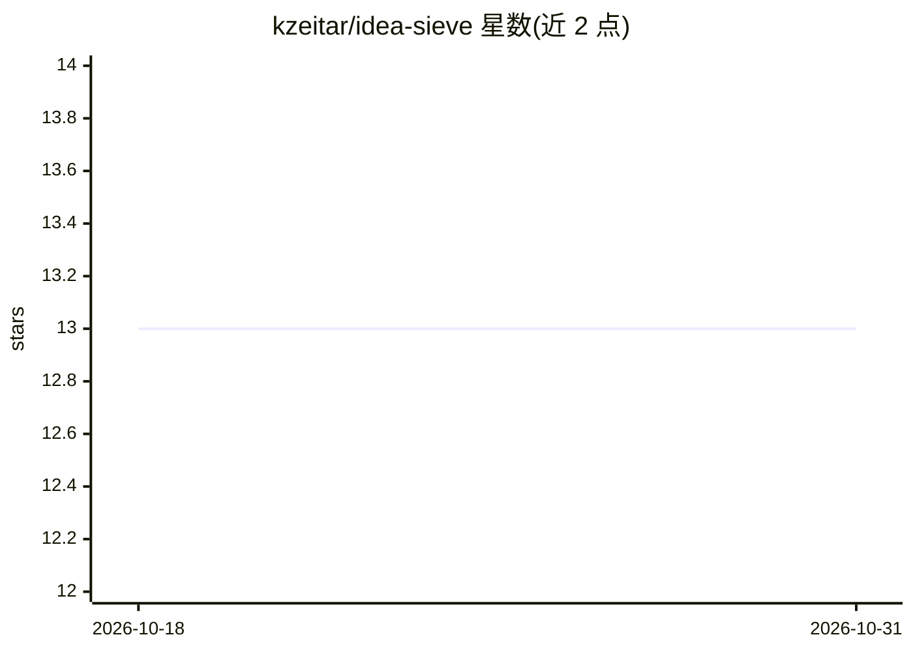

# kzeitar/idea-sieve

⭐ 13 · TypeScript · MIT · 推送 2026-01-24 · [GitHub](https://github.com/kzeitar/idea-sieve) · 个人维护

**面向创业/产品想法的 AI 验证工具：生成证据式评估报告**

自托管的全栈 Web 应用：用户提交创业或产品想法后，后端创建验证任务，AI agent 调用 OpenAI 与 Tavily 搜索执行多阶段研究与竞品分析，经 SSE 实时推送进度，最终产出含评分与建议的验证报告，存入 PostgreSQL。提供四种评估语气（Brutal/Balanced/Encouraging/Optimistic），支持 SaaS、移动应用、Chrome 扩展等八类想法。技术栈为 React 19 + Hono + Bun + Prisma，官方推荐 Docker Compose 部署；README 声明输出为 AI 生成、可能不准确，不构成专业建议。

## 筛选速览

| 维度 | 判定 | 备注 |
|---|---|---|
| AI 角色 | `ai-native` | 本体是模型或模型工具 |
| 许可风险 | `permissive` | MIT |
| 部署形态 | `self-host` | docker 或自建部署 |
| 模型依赖 | — | README 未给出锁定关系 |
| 硬件要求 | — | 无带数字的原话,不猜 |
| 安装摩擦 | `low` | 无编译、无系统依赖或容器化 |
| 成熟度 | — | 结构信号不足 |

## 能力要点

- 多阶段 AI 验证任务，SSE 实时推送进度
- 基于 Tavily 搜索的竞品研究与证据式评估
- 四种可配置评估语气（Brutal/Balanced/Encouraging/Optimistic）
- 支持 SaaS、移动应用、Chrome 扩展等八类想法类型

## 适用场景

- 在投入开发前验证 SaaS 或 App 想法的可行性
- 获取基于网络搜索的竞品与市场分析
- 以不同语气（如严厉/鼓励）获得创业想法反馈

## 场景标签

`科研工具` `网页抓取` · 领域:效率与自动化

## 证据(README 行号)

> L171: 1. User submits an idea through the React frontend
> L173: 3. AI agent performs research tasks using OpenAI and Tavily
> L175: 5. User receives a comprehensive validation report

## 星数曲线

2026-10-18 13 → 2026-10-31 13（+0）

---
*卡片 v1 · prompt 1.4 · 生成 2026-10-31 · 置信度 mid · 依据 README sha `08317081d165` · [字段定义](../../DATASET.md)*
