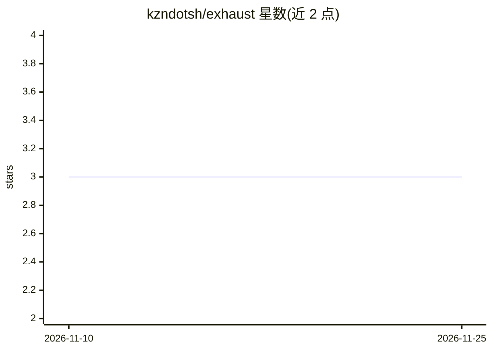

# kzndotsh/exhaust

⭐ — · [GitHub]() · 个人维护

**面向安全研究的 agent 工具包：驱动 agent 详尽探测授权目标**

为每个授权 Target 生成自包含 Workspace，内含固定版本工具集（Rig，先钉 nmap/curl）、待遍历的垂直项清单（Playbook）与驱动 agent 循环的 Harness。关键机制包括：Scope Contract 门控真实目标测试（无契约仅限沙箱）、append-only 的 Findings 存储、confirmed 判定需宿主机侧 Oracle 验证、不可信目标输出以定界符标记为数据、重大操作需人工审批、本地代理托管 LLM 凭据并做预算控制。项目处于 pre-alpha 阶段，部分机制（如 Oracle 实际检查）尚未接线。

## 筛选速览

| 维度 | 判定 | 备注 |
|---|---|---|
| AI 角色 | `ai-native` | 本体是模型或模型工具 |
| 许可风险 | `permissive` | — |
| 部署形态 | `None` |  |
| 模型依赖 | — | README 未给出锁定关系 |
| 硬件要求 | — | 无带数字的原话,不猜 |
| 安装摩擦 | `low` | 无编译、无系统依赖或容器化 |
| 成熟度 | `idea` | |

## 能力要点

- Workspace 脚手架 + Playbook 垂直项账本，按条目状态决定何时结束
- Scope Contract 失败即关闭、无契约默认仅沙箱，extent 分 recon/full
- confirmed 判定要求宿主运行 Oracle，不采信 agent 自报
- 本地凭据代理：agent 不持有真实 LLM key，带预算上限与用量计价

## 适用场景

- 对自己拥有或获明确授权测试的系统做 agent 驱动的安全探测
- 以 Scope Contract 约束渗透测试范围并留存不可篡改的 Findings 记录
- 对 agent 的重大操作（真实目标有影响的调用）引入人工审批流程

## 场景标签

`网络安全` · 领域:学习与行业

## 证据(README 行号)

> L3:  An agent-first toolkit for security research.
> L13: You scaffold a self-contained **Workspace** per **Target**, and exhaust gives an agent what it needs to probe that 

## 星数曲线

2026-11-10 3 → 2026-11-25 3（+0）

---
*卡片 v1 · prompt 1.4 · 生成 2026-11-21 · 置信度 mid · 依据 README sha `74b7a5b84e76` · [字段定义](../../DATASET.md)*
