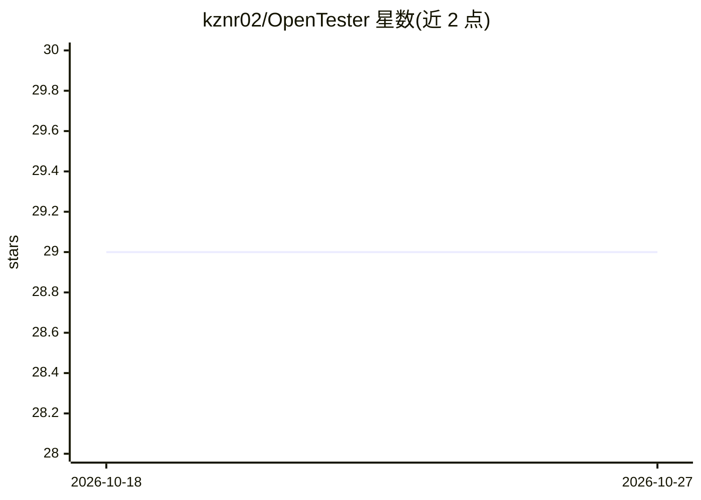

# kznr02/OpenTester

⭐ 29 · Python · MIT · 推送 2026-03-23 · [GitHub](https://github.com/kznr02/OpenTester) · 个人维护 · 中文 README

**面向 AI 编码工具的 MCP 测试执行引擎，统一 DSL 生成与运行**

为 Claude Code、Cursor、OpenCode 等 AI 编码工具设计的测试执行基础设施：以 MCP 接口暴露全部核心功能，提供 YAML DSL 格式与校验，Agent 负责生成测试用例与分析失败原因，OpenTester 负责执行。执行目标覆盖 CLI（subprocess）、WEB（Playwright 浏览器自动化），GUI/TUI 执行器为实验性且默认禁用。支持暂停等待 AI 提交选择器、DOM 快照与截图供 AI 分析。通过 pip 安装，FastAPI 提供 Web UI 与 REST API 作为辅助入口。

## 筛选速览

| 维度 | 判定 | 备注 |
|---|---|---|
| AI 角色 | `ai-ecosystem` | LLM/agent 周边工具 |
| 许可风险 | `permissive` | MIT |
| 部署形态 | `desktop` | 安装包/桌面程序 |
| 模型依赖 | — | README 未给出锁定关系 |
| 硬件要求 | — | 无带数字的原话,不猜 |
| 安装摩擦 | `low` | 无编译、无系统依赖或容器化 |
| 成熟度 | — | 结构信号不足 |

## 能力要点

- MCP 接口暴露 19 个工具，覆盖项目/用例/执行/模板管理
- YAML DSL 校验与执行，支持 CLI 与 Playwright Web 自动化
- 执行可暂停等待 AI 选择器提交，附带 DOM 快照与浏览器诊断事件
- 项目数据按 XDG 规范持久化，含 PRD、用例版本与模板库

## 适用场景

- 让 Claude Code 等 Agent 生成并执行测试，形成 code-test-fix 工作流
- 通过 Web UI 可视化监控测试执行进度与历史报告
- Web 测试中让 AI 分析 DOM 快照并提交定位选择器

## 场景标签

 · 领域:软件测试/AI 工具基础设施

## 证据(README 行号)

> L9: OpenTester is a testing execution engine designed for AI coding tools (Claude Code, Cursor, OpenCode, etc.). It prov
> L25: - **MCP-First**: All core features exposed through MCP
> L204: **Note**: Web UI is not the main entry point. All core features are provided through MCP.

## 星数曲线

2026-10-18 29 → 2026-10-27 29（+0）

---
*卡片 v1 · prompt 1.4 · 生成 2026-10-26 · 置信度 high · 依据 README sha `2b7c8608c427` · [字段定义](../../DATASET.md)*
