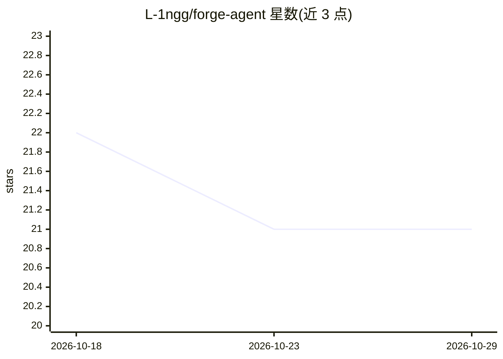

# L-1ngg/forge-agent

⭐ 21 · TypeScript · MIT · 推送 2026-10-05 · [GitHub](https://github.com/L-1ngg/forge-agent) · 个人维护 · 中文 README

**面向终端与 Bun 应用的可扩展单 Agent 工具包**

基于 Bun 与 TanStack AI 的单 Agent 框架：提供 CLI/TUI 交互式终端用于探索代码库、编辑文件、运行命令，支持工具审批、上下文压缩、Markdown 记忆、Skills 与 MCP 接入外部工具；另以 SDK 形式将 Agent 嵌入 Bun 应用，由宿主自定义工具、提示、权限与存储。运行目标为 Linux/macOS 上的 Bun，包尚未发布到 npm，为个人开发中项目，API 可能变动。

## 筛选速览

| 维度 | 判定 | 备注 |
|---|---|---|
| AI 角色 | `ai-ecosystem` | LLM/agent 周边工具 |
| 许可风险 | `permissive` | MIT |
| 部署形态 | `None` |  |
| 模型依赖 | — | README 未给出锁定关系 |
| 硬件要求 | — | 无带数字的原话,不猜 |
| 安装摩擦 | `low` | 无编译、无系统依赖或容器化 |
| 成熟度 | `idea` | |

## 能力要点

- CLI/TUI/SDK 共享同一 AgentSession 架构
- 工具审批、上下文压缩、Markdown 记忆与 MCP 连接
- SDK 可嵌入 Bun 应用，支持自定义工具与权限
- 支持 OpenTelemetry 导出模型与工具追踪

## 适用场景

- 在终端里让 Agent 探索代码库、编辑文件、执行命令
- 在自己的 Bun 应用中嵌入带自定义工具的单 Agent
- 通过 MCP 接入外部工具并在会话间保留记忆

## 场景标签

`Agent 框架` · 领域:Agent 开发

## 证据(README 行号)

> L8: Use Forge to explore a codebase, edit files, run commands, and continue work across sessions. Embed the same agent i
> L10: Forge includes an interactive terminal, tool approvals, context compaction, and Markdown memory. Skills provide reu
> L86: The CLI, TUI, and SDK share one `AgentSession`. Forge manages input, configuration, permissions, session history, a

## 星数曲线

2026-10-18 22 → 2026-10-29 21（-1）

---
*卡片 v1 · prompt 1.4 · 生成 2026-10-28 · 置信度 high · 依据 README sha `c3bfc1b88c4f` · [字段定义](../../DATASET.md)*
