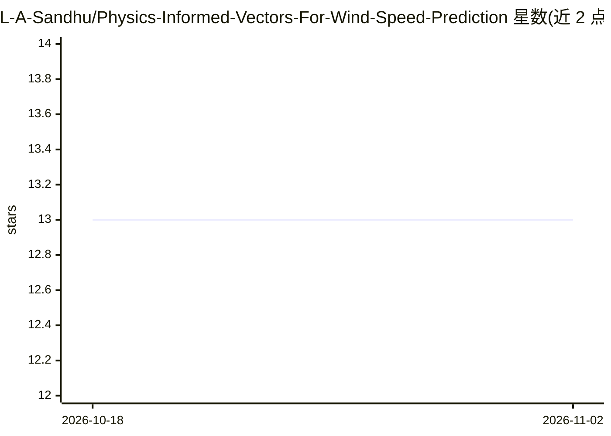

# L-A-Sandhu/Physics-Informed-Vectors-For-Wind-Speed-Prediction

⭐ 13 · Python · CC0-1.0 · 推送 2026-07-02 · [GitHub](https://github.com/L-A-Sandhu/Physics-Informed-Vectors-For-Wind-Speed-Prediction) · 个人维护

**物理信息向量增强的 LSTM/TCN 风速预测框架**

论文官方实现：在 LSTM 与时间卷积网络（TCN）的时序预测框架中，将物理信息向量作为输入特征并纳入损失函数，用于风速预测。以代码仓库形式提供，通过 git clone 克隆并设置虚拟环境运行。适用于可再生能源领域的风速预测研究，机制围绕物理约束与神经网络结合展开。

## 筛选速览

| 维度 | 判定 | 备注 |
|---|---|---|
| AI 角色 | `ai-native` | 本体是模型或模型工具 |
| 许可风险 | `viral` | CC0-1.0 |
| 部署形态 | `None` |  |
| 模型依赖 | — | README 未给出锁定关系 |
| 硬件要求 | — | 无带数字的原话,不猜 |
| 安装摩擦 | `low` | 无编译、无系统依赖或容器化 |
| 成熟度 | — | 结构信号不足 |

## 能力要点

- LSTM 与 TCN 两种时序预测网络实现
- 物理信息向量作为输入与损失函数组成部分
- 风速预测任务的官方论文实现

## 适用场景

- 复现物理信息风速预测论文方法
- 研究者对比 LSTM 与 TCN 在时序预测中的表现
- 可再生能源领域的风速预测建模参考

## 场景标签

`科研工具` · 领域:学习与行业

## 证据(README 行号)

> L1: # Time Series Forecasting with LSTM and TCN Models
> L2: This project implements a machine learning framework for time series forecasting using Long Short-Term Memory (LSTM)

## 星数曲线

2026-10-18 13 → 2026-11-02 13（+0）

---
*卡片 v1 · prompt 1.4 · 生成 2026-10-31 · 置信度 high · 依据 README sha `9c521dfbbc57` · [字段定义](../../DATASET.md)*
