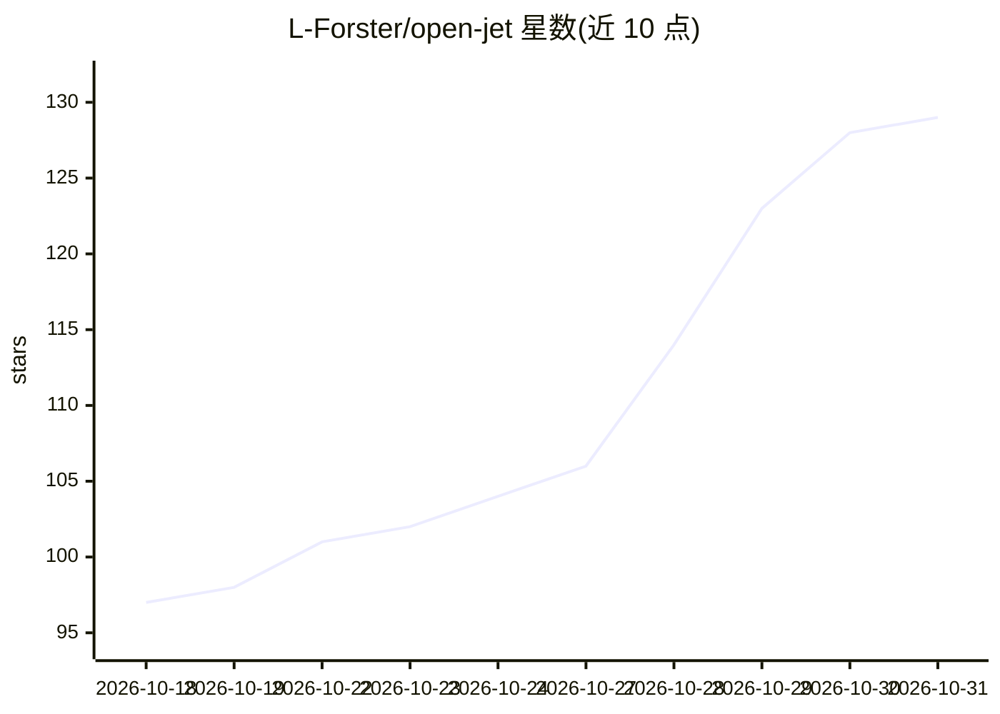

# L-Forster/open-jet

⭐ 129 · Python · AGPL-3.0 · 推送 2026-10-30 · [GitHub](https://github.com/L-Forster/open-jet) · [官网](https://www.openjet.dev/) · 个人维护

**本地模型离线编程 agent 与自带 CUDA 推理引擎**

自托管的终端编程 agent 加本地 LLM 运行时：setup 检测 GPU 与内存，从目录中选取适配的 GGUF 模型并下载，构建 llama-server 或编译自研 CUDA megakernel，随后提供可编辑文件、执行需批准命令、支持 MCP 工具的 agent。也可连接已有的 Ollama/LM Studio/llama-server 服务，或通过 Python SDK 把模型嵌入应用；Slipstream 模式让云端模型规划、本地模型执行。megakernel 仅支持 RTX 30/40/50 系 24GB+ 显卡上的 Qwen3.8-27B 特定量化，其余模型走 llama.cpp；CPU-only 可运行。

## 筛选速览

| 维度 | 判定 | 备注 |
|---|---|---|
| AI 角色 | `ai-native` | 本体是模型或模型工具 |
| 许可风险 | `viral` | AGPL-3.0 |
| 部署形态 | `library` | 以包/库形式分发 |
| 模型依赖 | local-ok | 支持本地模型 |
| 硬件要求 | `cpu-ok` | |
| 安装摩擦 | `medium` | 含编译或系统依赖之一 |
| 成熟度 | — | 结构信号不足 |

## 能力要点

- setup 自动检测硬件并选择/下载适配的 GGUF 模型
- 面向 Qwen3.8-27B Q4_K_M 的自研 CUDA megakernel（RTX 30/40/50 系 24GB+）
- 支持 chat/code/review/debug 四种模式、MCP 工具与设备源
- Python SDK 可按目标设备预算模型并打包进应用，运行时零下载

## 适用场景

- 在无账号无 API key 的环境下离线运行终端编程 agent
- 让 24GB+ 显卡的 RTX 主机以自研 CUDA 引擎服务 Qwen3.8-27B
- 接入已有的 Ollama/LM Studio/llama-server 模型服务
- Slipstream 模式下用云端模型规划、本地模型改代码跑测试

## 场景标签

`编码 Agent` `推理引擎` · 领域:编码与开发

## 证据(README 行号)

> L7: OpenJet is an open-source, self-hosted AI coding assistant and local LLM runtime. Run a
> L249: **What is OpenJet?** An open-source local AI coding agent, Python SDK and LLM inference runtime.

## 星数曲线

2026-10-18 97 → 2026-10-31 129（+32）

---
*卡片 v1 · prompt 1.4 · 生成 2026-10-23 · 置信度 high · 依据 README sha `1ff2556974a3` · [字段定义](../../DATASET.md)*
