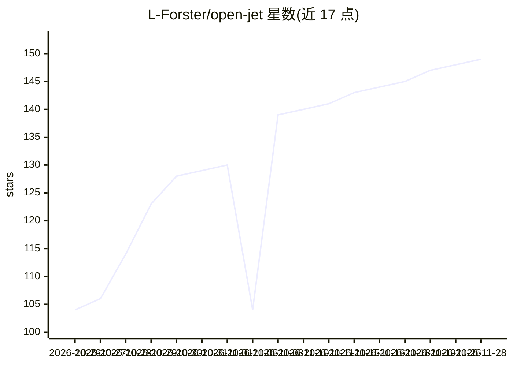

# L-Forster/open-jet

⭐ 149 · Python · AGPL-3.0 · 推送 2026-11-25 · [GitHub](https://github.com/L-Forster/open-jet) · [官网](https://www.openjet.dev/) · 个人维护

**本地模型的离线编码 agent 与推理引擎，一条命令配好 GPU 可跑的模型**

OpenJet 是一个面向本地模型的推理引擎与编码 agent 工具链：`openjet setup` 检测 GPU 并下载对应预编译引擎与模型（Qwen3.8-27B / Inkling 2 Mini），自带终端编码 agent（有界上下文、自动压缩、shell 命令审批、会话恢复、skills 与 MCP），也可通过 `openjet serve` 以 Anthropic Messages / OpenAI Responses / Chat Completions 协议向 Claude Code、Codex、OpenCode、OpenClaw 提供服务。README 声明在 RTX 3090 24GB 上较 llama.cpp 有倍速提升数据，并提供 `openjet bench` 社区基准与 Python SDK。支持 4 个 agent 共享单 GPU 解码。

## 筛选速览

| 维度 | 判定 | 备注 |
|---|---|---|
| AI 角色 | `ai-ecosystem` | LLM/agent 周边工具 |
| 许可风险 | `viral` | AGPL-3.0 |
| 部署形态 | `library` | 以包/库形式分发 |
| 模型依赖 | — | README 未给出锁定关系 |
| 硬件要求 | `gpu-24g` | |
| 安装摩擦 | `low` | 无编译、无系统依赖或容器化 |
| 成熟度 | — | 结构信号不足 |

## 能力要点

- 一条命令检测 GPU 并下载匹配的预编译引擎与模型
- 自带终端编码 agent：上下文压缩、命令审批、会话恢复、skills、MCP
- openjet serve 兼容 Anthropic Messages / OpenAI 协议，可接入 Claude Code、Codex、OpenCode、OpenClaw
- 单 GPU 支持最多 4 个 agent 同时解码（README 称 RTX 3090 上共约 420 tok/s）

## 适用场景

- 在本地 RTX 显卡上离线运行编码 agent，不经云服务
- 为 Claude Code / Codex 等编码工具提供本地模型后端
- 无本地 GPU 时在 Vast.ai 租用 RTX 3090 部署
- 通过 Python SDK 把本地模型嵌入自己的应用

## 场景标签

`编码 Agent` `推理引擎` · 领域:编码与开发

## 证据(README 行号)

> L5:  NVIDIA RTX 30, 40 and 50-series GPUs (6-24 GB VRAM), plus AMD and Intel Vulkan laptops. Works with Claude Code, Cod
> L78: openjet setup      # finds your GPU, downloads the model and OpenJet's prebuilt engine for it
> L115: `openjet serve` speaks Anthropic Messages, OpenAI Responses and OpenAI Chat Completions;

## 星数曲线

2026-10-26 104 → 2026-11-28 149（+45）

---
*卡片 v1 · prompt 1.4 · 生成 2026-11-27 · 置信度 high · 依据 README sha `bc1669e2f251` · [字段定义](../../DATASET.md)*
