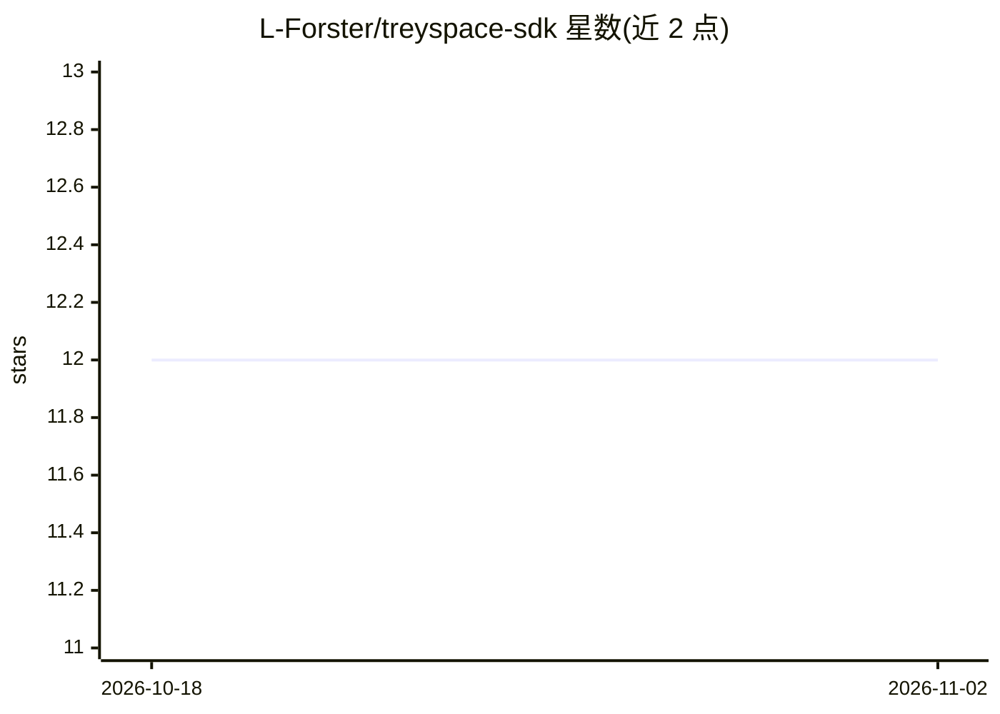

# L-Forster/treyspace-sdk

⭐ 12 · JavaScript · MIT · 推送 2025-12-27 · [GitHub](https://github.com/L-Forster/treyspace-sdk) · [官网](https://www.treyspace.app/) · 个人维护

**面向 Excalidraw 画布数据的 RAG 框架/SDK**

开源 Node.js/TypeScript SDK，对画布（canvas）知识图谱数据做 RAG：摄取画布数据，镜像到 Helix 图-向量数据库进行语义、关系与空间聚类，通过 SSE 端点编排完整 RAG 流水线并提供 LLM 分析。提供 OpenAI Responses API 封装、Helix 桥接与 MCP bridge 端点，可作为库使用或以独立服务器运行。默认使用内存图存储，Helix DB 为可选后端；面向开发用途，不含鉴权、限流与计费。需 Node.js>=18、npm>=9 与 OpenAI API key。

## 筛选速览

| 维度 | 判定 | 备注 |
|---|---|---|
| AI 角色 | `ai-ecosystem` | LLM/agent 周边工具 |
| 许可风险 | `permissive` | MIT |
| 部署形态 | `library` | 以包/库形式分发 |
| 模型依赖 | — | README 未给出锁定关系 |
| 硬件要求 | — | 无带数字的原话,不猜 |
| 安装摩擦 | `low` | 无编译、无系统依赖或容器化 |
| 成熟度 | — | 结构信号不足 |

## 能力要点

- 画布→Helix→LLM 的端到端 RAG 流水线（SSE 端点编排）
- 语义/关系/空间三种聚类与可视化
- 默认内存图存储，HelixDB 为可选后端（--enable_helix）
- 可作为库使用或独立服务器运行，含 /api/mcp-bridge 端点

## 适用场景

- 对 Excalidraw 画布内容做语义检索与 LLM 分析
- 在应用中接入画布知识图谱的 RAG 能力（SDK 库形式）
- 通过 Responses API 封装为画布场景提供带上下文的回答

## 场景标签

`RAG` `知识图谱` · 领域:知识与检索

## 证据(README 行号)

> L9: An open-source RAG (Retrieval-Augmented Generation) SDK for canvas-based knowledge graphs. It ingests canvas data, m
> L26: - **Canvas AI engine** – SSE endpoints under `/api/ai/*` orchestrate the full RAG pipeline with graph-based retriev

## 星数曲线

2026-10-18 12 → 2026-11-02 12（+0）

---
*卡片 v1 · prompt 1.4 · 生成 2026-11-01 · 置信度 high · 依据 README sha `36fa5bf08530` · [字段定义](../../DATASET.md)*
