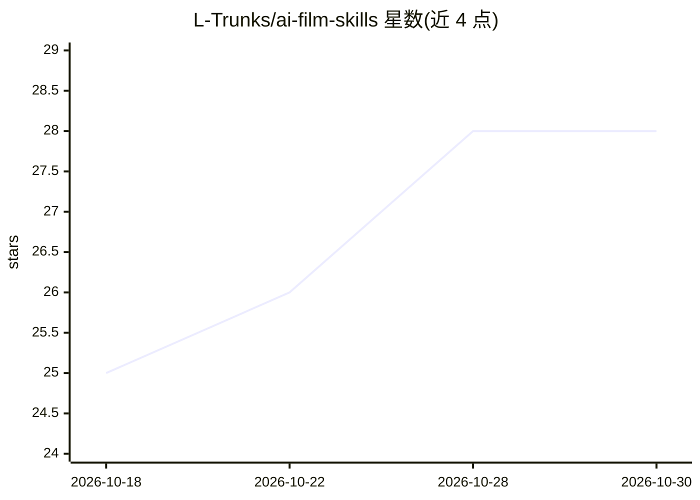

# L-Trunks/ai-film-skills

⭐ 28 · Python · NOASSERTION · 推送 2026-09-15 · [GitHub](https://github.com/L-Trunks/ai-film-skills) · 个人维护 · 中文 README

**本地 AI 短片创作方法论技能套件：决策知识+踩坑档案**

面向用本地模型（LTX/Wan/MiniMax H3）制作 AI 短片用户的六个 Claude Skills，内容为导演决策知识而非安装教程：五维正交变量+两层指纹的防同质化机制（阻止近期作品结构重复）、模型参数 profile 化与五步自校准流程（仅 ltx-2.3-q4-12g 含实测数据）、以及 1600+ 行可引用的踩坑文档。技能本体不依赖脚本、模型与 GPU；参考实现需配置路径并运行 doctor.py。附四部在 RTX 4070 Ti (12GB) 上完成的影片与制作拆解。

## 筛选速览

| 维度 | 判定 | 备注 |
|---|---|---|
| AI 角色 | `ai-knowledge` | 知识聚合/清单类 |
| 许可风险 | `none` | NOASSERTION |
| 部署形态 | `None` |  |
| 模型依赖 | — | README 未给出锁定关系 |
| 硬件要求 | — | 无带数字的原话,不猜 |
| 安装摩擦 | `medium` | 含编译或系统依赖之一 |
| 成熟度 | — | 结构信号不足 |

## 能力要点

- 五维正交变量 + vars/structure/signature 两层指纹的防同质化机制
- 模型依赖参数移入 profile，提供空白模板与五步自校准流程
- knowledge/pitfalls.md 踩坑文档（YUV 辉光偏紫、否定句不可直接提示、AI 人脸一致性阈值 0.28 等）
- 四部影片均在单张 RTX 4070 Ti (12GB) 上完成，生成路径无云 API

## 适用场景

- 用 12GB 显卡本地跑 LTX/H3 流水线制作短片
- 避免多部作品结构雷同、镜头设计撞车
- 换模型时校准自己的参数 profile 而非抄文档数字
- 查阅前人用 GPU 时间换来的踩坑经验

## 场景标签

`视频生成` · 领域:内容生成

## 证据(README 行号)

> L3: **A directing knowledge base for locally-generated AI short films** — six Claude Skills about *what to decide*, not 
> L9: > Then say "make a short film." The skill itself is methodology and knowledge; it depends on no scripts, no models, 

## 星数曲线

2026-10-18 25 → 2026-10-30 28（+3）

---
*卡片 v1 · prompt 1.4 · 生成 2026-10-26 · 置信度 high · 依据 README sha `54b1650c6291` · [字段定义](../../DATASET.md)*
