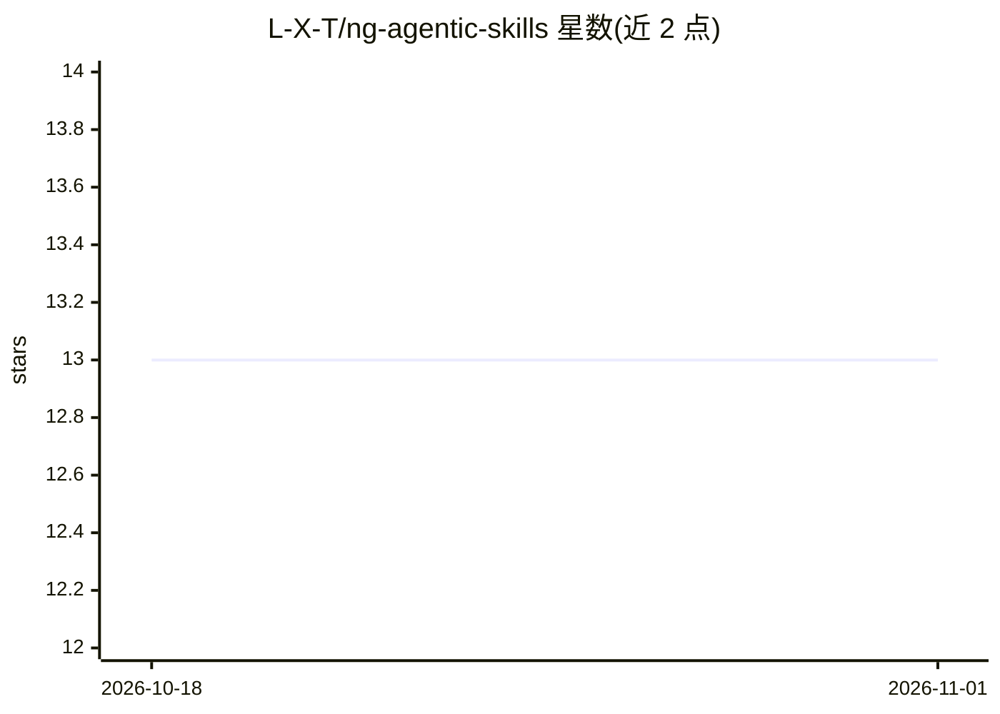

# L-X-T/ng-agentic-skills

⭐ 13 · Markdown · MIT · 推送 2026-10-04 · [GitHub](https://github.com/L-X-T/ng-agentic-skills) · [官网](https://speakerdeck.com/lx_t/agents-dot-md-is-not-enough-build-skills-dont-download-them) · 个人维护

**面向 Angular 开发的 AI agent 技能库，附博客系列配套**

一个 agent 技能库，覆盖 Angular 开发场景：signal 表单、数据访问、SignalStore 状态管理、迁移、重构、无障碍/性能/安全审查、单元与 e2e 测试、浏览器验证，以及技能编写、计划执行、TDD、代码评审等 agentic 过程技能。技能以 SKILL.md 文件夹形式存放在 .agents/skills/ 下，分为自研（MIT 许可）与改编自公开来源的第三方技能（来源记录于 skill-sources.json）。仓库同时包含 Angular 编码风格指南与面向 AI agent 的 AGENTS.md 操作契约，是 Agentic Engineering 博客系列与演讲的配套仓库。README 声明该指令集针对特定模型世代调校并需持续迭代。

## 筛选速览

| 维度 | 判定 | 备注 |
|---|---|---|
| AI 角色 | `ai-knowledge` | 知识聚合/清单类 |
| 许可风险 | `permissive` | MIT |
| 部署形态 | `None` |  |
| 模型依赖 | — | README 未给出锁定关系 |
| 硬件要求 | — | 无带数字的原话,不猜 |
| 安装摩擦 | `low` | 无编译、无系统依赖或容器化 |
| 成熟度 | — | 结构信号不足 |

## 能力要点

- SKILL.md 格式的技能文件夹，可选 references/scripts/assets 即时加载
- 自定义（MIT）与第三方技能分开，来源记录在 skill-sources.json
- 附带 Angular 编码风格指南与面向 AI agent 的 AGENTS.md 操作契约
- 配套 02-SKILLS.md 技能目录与 SKILL-MAINTENANCE.md 维护流程

## 适用场景

- 为 AI agent 添加 Angular 重构、测试与审查能力
- 参考技能编写与维护流程来构建自己的 agent 技能库
- 为 Angular 项目引入风格指南与 agent 操作契约

## 场景标签

`编码 Agent` · 领域:编码与开发

## 证据(README 行号)

> L3: A library of **agent skills** for Angular work – focused, reusable capabilities an AI agent can invoke
> L19: Skills live under `.agents/skills/`. Each skill is a folder with a `SKILL.md` plus optional
> L21: **custom** skills authored here (MIT-licensed) and **third-party** skills adapted from public sources

## 星数曲线

2026-10-18 13 → 2026-11-01 13（+0）

---
*卡片 v1 · prompt 1.4 · 生成 2026-10-31 · 置信度 high · 依据 README sha `3b72d27fd73c` · [字段定义](../../DATASET.md)*
