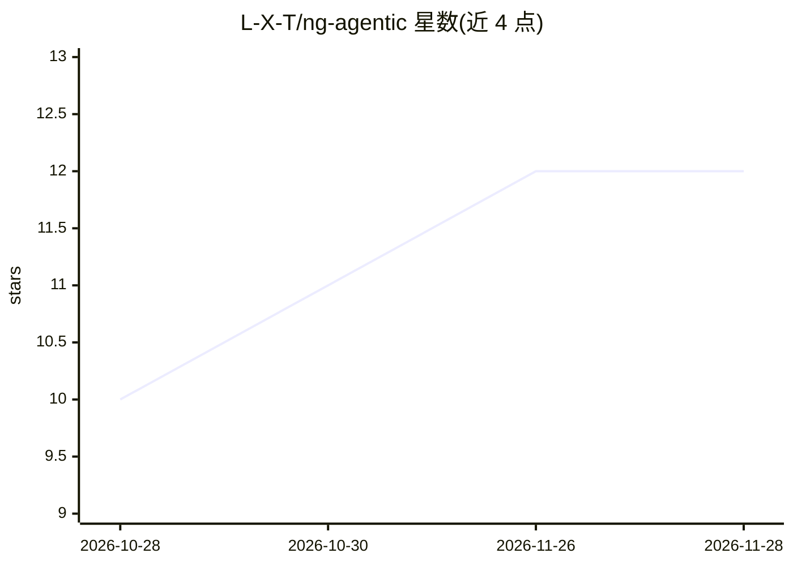

# L-X-T/ng-agentic

⭐ 12 · TypeScript · MIT · 推送 2026-11-27 · [GitHub](https://github.com/L-X-T/ng-agentic) · [官网](https://www.angulararchitects.io/blog/ae-harness-setup-for-angular/) · 个人维护

**为 Angular 开发者提供 AI 编码就绪的工作区脚手架**

一个由 Angular CLI 生成的 Angular 工作区模板，配套 workshop 教程逐步说明工程化配置：Husky 预提交钩子与 prettier 格式化、Angular ESLint 与 lint-staged、style-guide 目录下的编码风格指南，以及将 AGENTS.md 改写为面向 AI agent 的仓库级操作契约。注册 MCP 服务器（Angular CLI、Chrome DevTools、Figma 等）并为多种 AI 编码工具生成各自的配置文件，同时记录 lint/构建/调试/E2E 的 agent 反馈回路。需按教程自行生成与配置，非开箱即用的成品应用。

## 筛选速览

| 维度 | 判定 | 备注 |
|---|---|---|
| AI 角色 | `ai-enhanced` | 去掉 AI 部分产品仍成立 |
| 许可风险 | `permissive` | MIT |
| 部署形态 | `library` | 以包/库形式分发 |
| 模型依赖 | — | README 未给出锁定关系 |
| 硬件要求 | — | 无带数字的原话,不猜 |
| 安装摩擦 | `low` | 无编译、无系统依赖或容器化 |
| 成熟度 | — | 结构信号不足 |

## 能力要点

- AGENTS.md 作为仓库级 AI agent 操作契约（工作流规则、风格指南加载策略）
- 统一注册 MCP 服务器并镜像到多个 AI 工具的专属配置位置
- 为 Claude Code/Codex/Cursor 等多工具提供各自的 agent 指令文件
- lint/构建/Chrome 调试/E2E 组成的 agent 反馈回路实践

## 适用场景

- 为新 Angular 项目搭建带 agent 指令的工作区
- 让多个 AI 编码工具共享同一套项目约定与 MCP 服务器
- 参考其风格指南与预提交钩子配置规范团队代码质量

## 场景标签

`教程课程` · 领域:学习与行业

## 证据(README 行号)

> L7: A practical Angular workspace starter with modern best practices, AI-ready tooling, and scalable project setup guida
> L130: This commit turns `AGENTS.md` from a generic Angular guidance file into a repo specific operating contract for AI 
> L139: In the last commit we wrapped up the agentic tooling so every AI tool – Claude Code, Codex, Cursor, Cline, Junie, 

## 星数曲线

2026-10-28 10 → 2026-11-28 12（+2）

---
*卡片 v1 · prompt 1.4 · 生成 2026-11-19 · 置信度 mid · 依据 README sha `2edfdf4ac039` · [字段定义](../../DATASET.md)*
