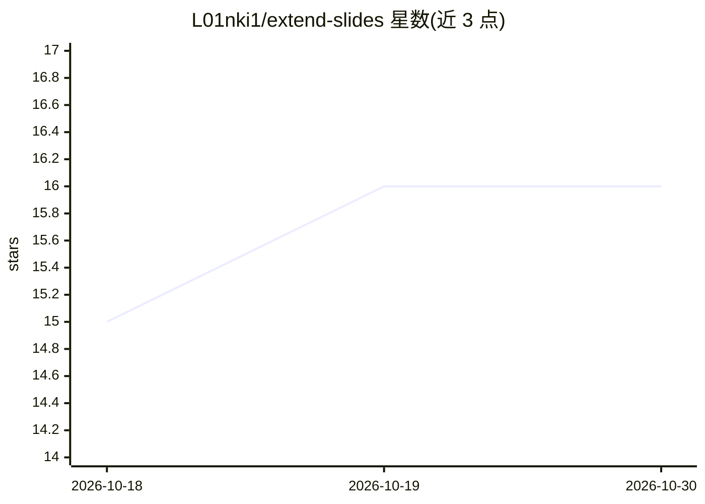

# L01nki1/extend-slides

⭐ 16 · Python · MIT · 推送 2026-10-12 · [GitHub](https://github.com/L01nki1/extend-slides) · 个人维护 · 中文 README

**把课件/讲义/录音转写扩展成中文复习讲解文档的 agent 技能**

以 SKILL.md 形式分发的 agent 技能：装入 Copilot/Claude 类 agent 后，可读取 PPTX、PDF、Word、Markdown、扫描件与课堂录音转写等课程资料，生成可脱离原资料独立复习的中文扩展讲解文档。核心约束为只增不删、保留原脉络，按学科提供四种讲解模式，首次使用记录课程档案实现跨会话沿用。依赖全部可选，OCR 缺失时纯图片页跳过；作者声明更适配理工科，其他学科未测试。

## 筛选速览

| 维度 | 判定 | 备注 |
|---|---|---|
| AI 角色 | `ai-ecosystem` | LLM/agent 周边工具 |
| 许可风险 | `permissive` | MIT |
| 部署形态 | `library` | 以包/库形式分发 |
| 模型依赖 | — | README 未给出锁定关系 |
| 硬件要求 | — | 无带数字的原话,不猜 |
| 安装摩擦 | `low` | 无编译、无系统依赖或容器化 |
| 成熟度 | `idea` | |

## 能力要点

- 覆盖 PPTX/PDF/Word/Markdown/扫描件/录音转写的课程资料输入
- 只增不删的覆盖度要求与四种讲解模式（计算/例题/理论/应用）
- _课程档案.md 实现同课程跨会话的模式沿用
- 附 extract_pptx.py 抽取脚本与 probe_env.py 环境探测脚本

## 适用场景

- 我把课堂 PPT 和讲义扩展成可独立复习的中文讲解笔记
- 期末复习时脱离原课件只用生成的文档回顾课程
- 把录音转写和课件合并成带术语表与章节索引的复习资料

## 场景标签

`AI 写作` · 领域:内容生成

## 证据(README 行号)

> L20: ├── SKILL.md                          # 主文件：何时用、流程、模式判定、硬性约束、检查清单
> L36: |个人级|`~/.copilot/skills/`、`~/.agents/skills/`、`~/.claude/skills/`（或你本机实际使用的 skills 根目录）|
> L37: |项目级|`<项目根>/.github/skills/`、`<项目根>/.agents/skills/`、`<项目根>/.claude/skills/`|

## 星数曲线

2026-10-18 15 → 2026-10-30 16（+1）

---
*卡片 v1 · prompt 1.4 · 生成 2026-10-30 · 置信度 mid · 依据 README sha `2ba15a4212ed` · [字段定义](../../DATASET.md)*
