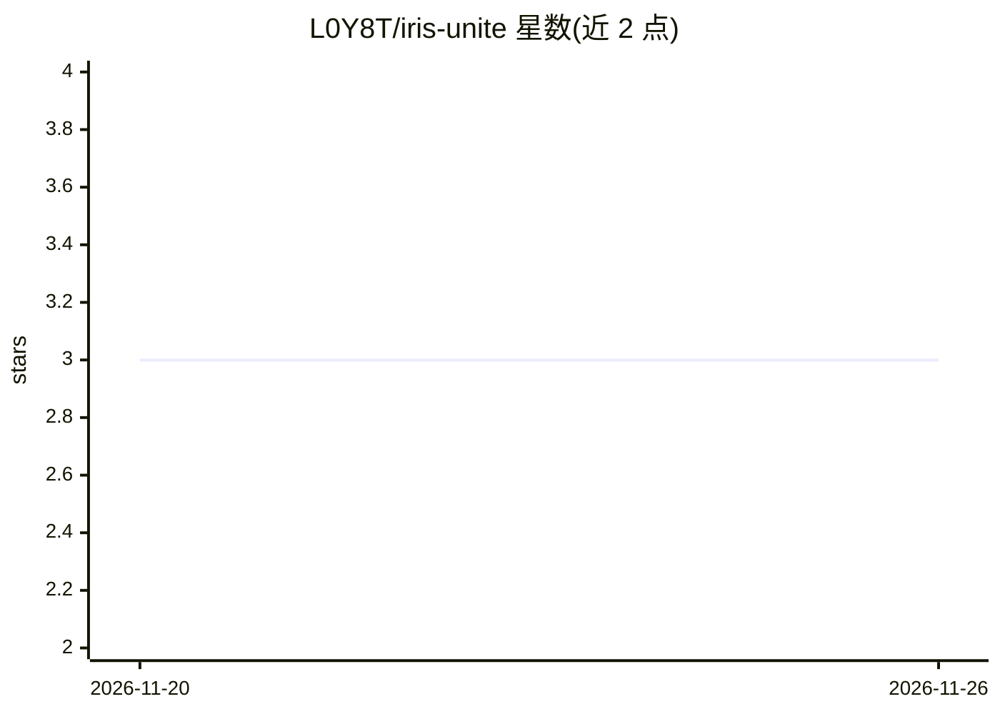

# L0Y8T/iris-unite

⭐ 3 · JavaScript · NOASSERTION · 推送 2026-11-24 · [GitHub](https://github.com/L0Y8T/iris-unite) · 个人维护 · 中文 README

**给科研人员的桌面工作台：检索真实文献并逐条核验引用**

Electron 桌面应用，按「检索→证据→推演→引用核验」流程工作：先从 OpenAlex/Crossref/arXiv/PubMed 取题录建资料库（无需 API Key），模型只能在证据范围内作答，生成后机械比对每个引用键、DOI/arXiv 号，指不回的引用替换为「未核实引用」。实验执行走受控 Python 模板，数字须绑定运行记录。三档 Profile 控制环节数与调用预算；仅 Windows 经真机验证，产物未签名。

## 筛选速览

| 维度 | 判定 | 备注 |
|---|---|---|
| AI 角色 | `ai-native` | 本体是模型或模型工具 |
| 许可风险 | `none` | NOASSERTION |
| 部署形态 | `desktop` | 安装包/桌面程序 |
| 模型依赖 | local-ok | 支持本地模型 |
| 硬件要求 | — | 无带数字的原话,不猜 |
| 安装摩擦 | `low` | 无编译、无系统依赖或容器化 |
| 成熟度 | — | 结构信号不足 |

## 能力要点

- 引用核验为机械比对：引用键/DOI/arXiv 号须精确指回资料库
- 检索 OpenAlex/Crossref/arXiv/PubMed 建资料库，无需 API Key
- 实验执行在独立 venv 运行受控模板，产物带 SHA-256 运行记录
- 支持 OpenAI/Anthropic 格式的任意服务商通道与本地 Ollama/vLLM

## 适用场景

- 写综述类科研答案时避免编造文献
- 核对草稿中每一处引用是否指回真实检索记录
- 跑内置模板实验并让答案中的数字绑定运行记录
- 接自建 OpenAI 兼容接口或多服务商模型做科研推演

## 场景标签

`科研工具` · 领域:学习与行业

## 证据(README 行号)

> L5: 一门面向**可核验科研**的桌面工作台：先检索真实文献建立资料库，再让多个模型在证据范围内推演、互相审查，最后把每一处引用逐个核对回资料库——指不回去的引用会被当场移除，而不是留在答案里充当真实出处。
> L40: 1. **先检索，后写作**。研究界定阶段产出检索式，检索阶段真的去 OpenAlex / Crossref / arXiv / PubMed 取题录（不需要任何 API Key），建立本轮资料库，每条记录分配一个引用键 `S1`
> L116: 设置 →「其他 AI 模型」里内置服务商预设，也可以连任何遵循 **OpenAI Chat Completions** 或 **Anthropic Messages** 的服务：

## 星数曲线

2026-11-20 3 → 2026-11-26 3（+0）

---
*卡片 v1 · prompt 1.4 · 生成 2026-11-22 · 置信度 high · 依据 README sha `eb94655b6199` · [字段定义](../../DATASET.md)*
