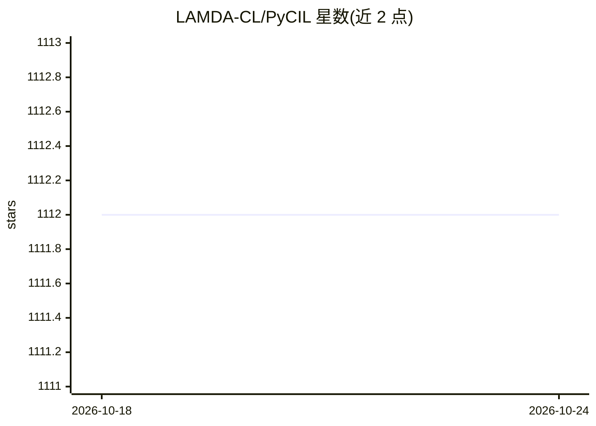

# LAMDA-CL/PyCIL

⭐ 1,112 · Python · NOASSERTION · 推送 2026-01-29 · [GitHub](https://github.com/LAMDA-CL/PyCIL) · 组织维护 · 中文 README

**类增量学习（CIL）算法复现与实验的 PyTorch 工具箱**

南京大学 LAMDA 实验室维护的类增量学习研究工具箱：复现 EWC、iCaRL、DER、FOSTER、SimpleCIL 等 20 余种 CIL 代表算法，覆盖从 2016 年基线到 2025 年会议论文方法，并在 CIFAR-100、ImageNet-100/1000 上提供复现结果。使用方式为 git clone 源码，编辑 JSON 配置与模型超参后以 python main.py 运行实验；CIFAR-100 自动下载，ImageNet 需自行指定数据目录。附 SCIS 2023 论文，MIT 许可。

## 筛选速览

| 维度 | 判定 | 备注 |
|---|---|---|
| AI 角色 | `ai-native` | 本体是模型或模型工具 |
| 许可风险 | `none` | NOASSERTION |
| 部署形态 | `None` |  |
| 模型依赖 | — | README 未给出锁定关系 |
| 硬件要求 | — | 无带数字的原话,不猜 |
| 安装摩擦 | `low` | 无编译、无系统依赖或容器化 |
| 成熟度 | — | 结构信号不足 |

## 能力要点

- 复现 20 余种类增量学习算法（EWC/iCaRL/DER/FOSTER 等）
- CIFAR-100、ImageNet-100/1000 基准复现结果
- JSON 配置驱动实验：memory-size/init-cls/increment/backbone/seed 可调
- 配套 CIL PyTorch 教程与中文简介阅读材料

## 适用场景

- 复现类增量学习论文结果作为研究基线
- 在新数据集设置下对比多种 CIL 算法
- 基于统一框架开发与评测新的增量学习方法

## 场景标签

`模型评测` `科研工具` · 领域:评测与运维

## 证据(README 行号)

> L14: Welcome to PyCIL, perhaps the toolbox for class-incremental learning with the **most** implemented methods. This is
> L49: Traditional machine learning systems are deployed under the closed-world setting, which requires the entire trainin

## 星数曲线

2026-10-18 1,112 → 2026-10-24 1,112（+0）

---
*卡片 v1 · prompt 1.4 · 生成 2026-10-21 · 置信度 high · 依据 README sha `5bd034956d9a` · [字段定义](../../DATASET.md)*
