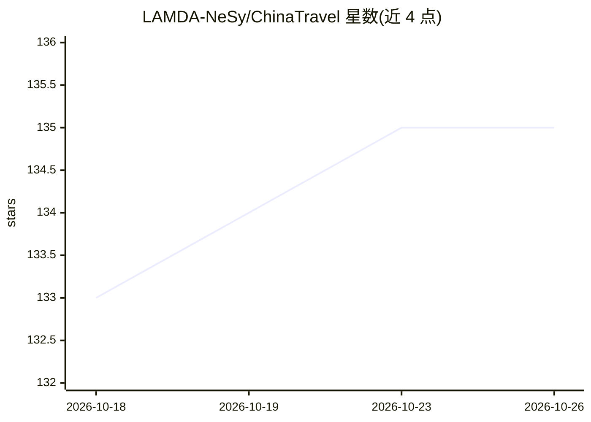

# LAMDA-NeSy/ChinaTravel

⭐ 135 · Python · MIT · 推送 2026-09-15 · [GitHub](https://github.com/LAMDA-NeSy/ChinaTravel) · [官网](https://sh-jj.github.io/ChinaTravel/index.html) · 组织维护 · 中文 README

**面向语言 Agent 的中文真实旅行规划基准（评测数据集+评估器）**

LAMDA-NeSy 维护的旅行规划基准：提供中英双语结构化沙盒数据、自然语言查询、可执行 DSL 约束、常识校验与偏好打分；含 Agent 运行入口、评估脚本、agent_env（Python/CLI/HTTP/MCP 接口）与合成查询生成、翻译审计工具链。模型通过 OpenAI 兼容端点接入（内置 deepseek/gpt-4o/glm4-plus 别名）。作为 IJCAI 2025/2026 Travel Planning Challenge 官方基准。需 Python 3.12+，沙盒数据从 Hugging Face/ModelScope 下载。

## 筛选速览

| 维度 | 判定 | 备注 |
|---|---|---|
| AI 角色 | `ai-knowledge` | 知识聚合/清单类 |
| 许可风险 | `permissive` | MIT |
| 部署形态 | `library` | 以包/库形式分发 |
| 模型依赖 | — | README 未给出锁定关系 |
| 硬件要求 | — | 无带数字的原话,不猜 |
| 安装摩擦 | `low` | 无编译、无系统依赖或容器化 |
| 成熟度 | — | 结构信号不足 |

## 能力要点

- 结构化沙盒+自然语言查询+可执行 DSL 约束+常识与偏好评估
- agent_env 提供 Python/CLI/HTTP/MCP/Chat Completions 工具调用接口
- 含合成查询生成、中英翻译审计与数据修复工具链
- IJCAI 2025/2026 Travel Planning Challenge 官方基准

## 适用场景

- 评测语言 Agent 在约束丰富的旅行规划任务上的表现
- 参加或复现 TPC 竞赛的提交与评分流程
- 生成并审计带可执行约束的合成旅行查询

## 场景标签

`模型评测` · 领域:评测与运维

## 证据(README 行号)

> L5: ChinaTravel is a real-world travel-planning benchmark for language agents. It
> L6: combines structured sandbox data, natural-language requests, executable DSL
> L7: constraints, commonsense validation, and preference-based scoring.

## 星数曲线

2026-10-18 133 → 2026-10-26 135（+2）

---
*卡片 v1 · prompt 1.4 · 生成 2026-10-23 · 置信度 high · 依据 README sha `fa597b75f69c` · [字段定义](../../DATASET.md)*
