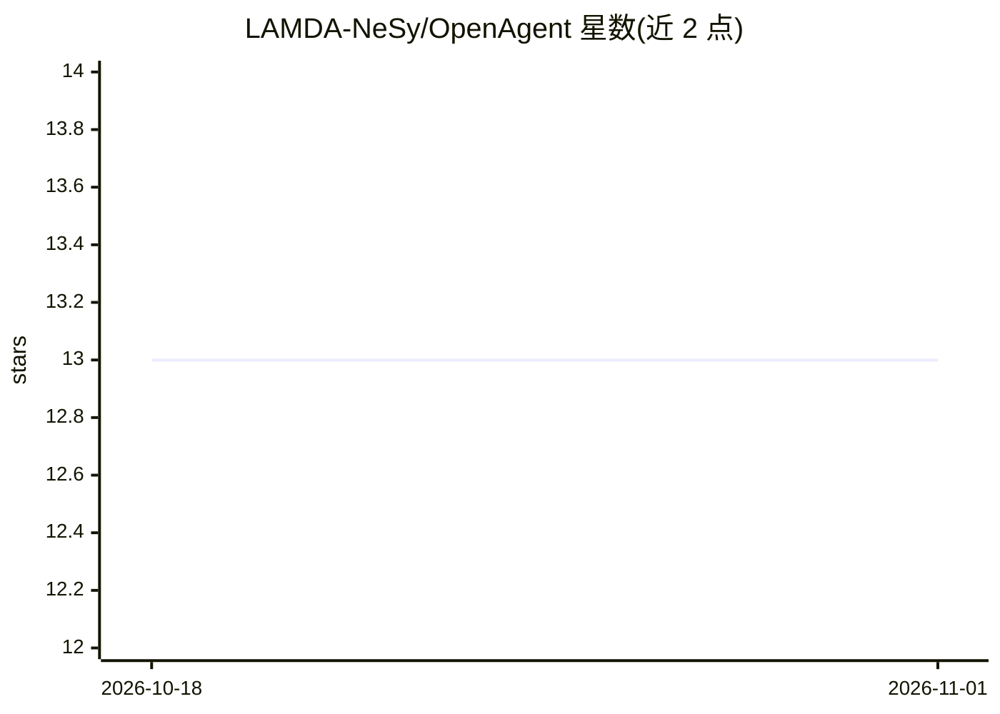

# LAMDA-NeSy/OpenAgent

⭐ 13 · Python · MIT · 推送 2026-06-03 · [GitHub](https://github.com/LAMDA-NeSy/OpenAgent) · [官网](https://wuwm109.github.io/OpenAgent-Page/) · 组织维护 · 中文 README

**评测工具使用 agent 开放世界泛化能力的沙盒基准**

南京大学 LAMDA 团队提出的 OpenAgent 基准官方实现：在受控沙盒中测试静态训练的工具使用 agent 在推理阶段遭遇查询改写、工具重命名、观测噪声、领域迁移（POI→医疗）时的泛化能力。评测按感知/交互/推理/内化四层组织，含 12 个场景配置；仓库提供数据生成、沙盒工具、评测运行器与冒烟测试。数据生成中的 LLM 查询改写为可选功能，需配置 OPENAI_API_KEY。

## 筛选速览

| 维度 | 判定 | 备注 |
|---|---|---|
| AI 角色 | `ai-ecosystem` | LLM/agent 周边工具 |
| 许可风险 | `permissive` | MIT |
| 部署形态 | `library` | 以包/库形式分发 |
| 模型依赖 | — | README 未给出锁定关系 |
| 硬件要求 | — | 无带数字的原话,不猜 |
| 安装摩擦 | `low` | 无编译、无系统依赖或容器化 |
| 成熟度 | — | 结构信号不足 |

## 能力要点

- 四层诊断层级：感知/交互/推理/内化
- 支持查询/动作/观测/领域四类环境偏移的受控独立变化
- 12 个预置评测场景配置（含医疗领域迁移）
- 提供数据生成、沙盒工具、评测运行器与冒烟测试

## 适用场景

- 评测自训练工具使用 agent 在开放环境偏移下的泛化性
- 生成带可配置偏移的工具使用训练/测试数据
- 按四层诊断定位 agent 失效环节

## 场景标签

`模型评测` · 领域:评测与运维

## 证据(README 行号)

> L27: Official implementation of **OpenAgent**, a controlled sandbox benchmark for testing whether tool-use agents traine
> L34: - **Diagnosis:** The evaluation is organized into four tiers: Perception, Interaction, Reasoning, and Internalizati

## 星数曲线

2026-10-18 13 → 2026-11-01 13（+0）

---
*卡片 v1 · prompt 1.4 · 生成 2026-10-31 · 置信度 high · 依据 README sha `6fc0d7c35e30` · [字段定义](../../DATASET.md)*
