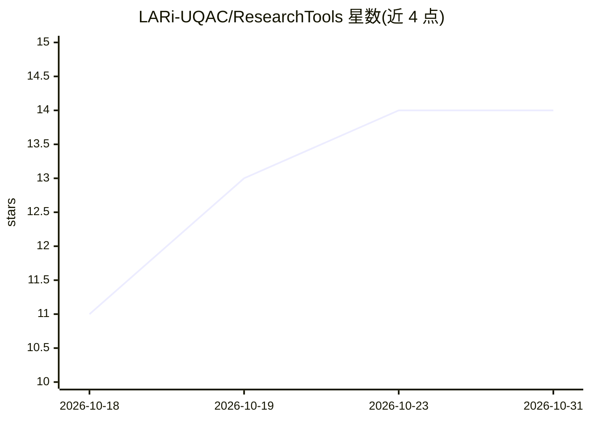

# LARi-UQAC/ResearchTools

⭐ 14 · Python · NOASSERTION · 推送 2026-10-26 · [GitHub](https://github.com/LARi-UQAC/ResearchTools) · 组织维护

**面向研究者的 AI 辅助工具箱：审计论文/论文/代码/PCB/CAD 设计**

为教授与研究生提供的 AI 辅助工具集，构建于 Claude Code 的 commands/agents/skills 之上，并镜像到 Copilot、OpenCode、Continue、Aider、Codex 等 7 类 Harness。功能分三块：学术写作审计（文献综述、论文与学位论文审计、BibTeX 清理、Scopus 校验、pdf2md 转换）、代码/PCB/3D CAD 设计审查、以及由本地模型承担常规生成的开发回路（local-writer/local-coder）。配有 rt-observe 实时仪表盘、Obsidian 与 graphify 双记忆、git 隐私守卫（25 个技能、R0-R38 规则、多组 hooks）。仅支持 Windows，以 PowerShell 脚本安装，许可证为 PolyForm Noncommercial 1.0.0（非商业）。作者声明工具不用于正式专业评估，决策权保留给人。

## 筛选速览

| 维度 | 判定 | 备注 |
|---|---|---|
| AI 角色 | `ai-native` | 本体是模型或模型工具 |
| 许可风险 | `none` | NOASSERTION |
| 部署形态 | `None` |  |
| 模型依赖 | locked-api |  |
| 硬件要求 | — | 无带数字的原话,不猜 |
| 安装摩擦 | `low` | 无编译、无系统依赖或容器化 |
| 成熟度 | — | 结构信号不足 |

## 能力要点

- 基于 Claude Code agents/skills/commands，镜像到 GitHub Copilot/OpenCode/Continue/Aider/Codex 等 7 类 Harness
- 论文/学位论文审计、引用贡献核验（extract-contributions）、Scopus 校验与 BibTeX 清理
- local-writer/local-coder 将常规生成交给本地模型，opt-local-vram-llm 按显卡调优上下文窗口
- rt-observe 仪表盘实时观测会话，配合 Obsidian vault 与 graphify 代码图双记忆

## 适用场景

- 投稿或答辩前对论文/学位论文做结构与引用审计
- 把常规写作与代码生成转到本地模型以减少云端开销
- 审查代码、PCB 与 3D CAD 设计并观察 agent 工作过程

## 场景标签

`科研工具` `代码审查` `代码生成` `AI 写作` · 领域:编码与开发

## 证据(README 行号)

> L23: ResearchTools is an AI-assisted toolbox for researcher-professors and graduate students. It finds and fixes what's 
> L27: - Code, PCB, and 3D CAD design review, with a dashboard to watch the agents work, and log them.
> L48: |Burn cloud tokens on routine docstrings and refactors|`local-writer` / `local-coder` push that generation to a loc

## 星数曲线

2026-10-18 11 → 2026-10-31 14（+3）

---
*卡片 v1 · prompt 1.4 · 生成 2026-10-31 · 置信度 high · 依据 README sha `133ae4e55852` · [字段定义](../../DATASET.md)*
