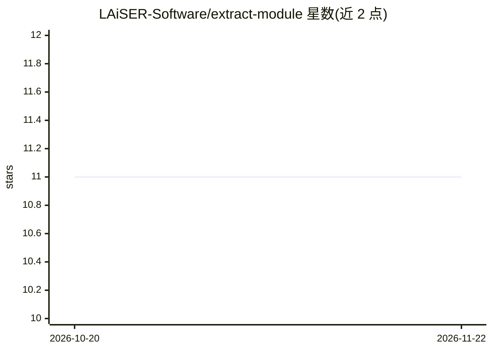

# LAiSER-Software/extract-module

⭐ 11 · Python · BSD-3-Clause · 推送 2026-11-08 · [GitHub](https://github.com/LAiSER-Software/extract-module) · [官网](laiser-software.github.io/extract-module/) · 组织维护

**从职位与课程文本抽取结构化技能并对齐标准分类库**

LAiSER 是一个 Python 包，将职位描述、课程大纲等非结构化文本经语言模型抽取为技能、知识与任务，并通过嵌入相似度匹配到 ESCO、O*NET、UK Skills Classification、Open Skills Network 分类条目，输出带相似度分数的对齐表格。抽取阶段可调用 Gemini/OpenAI 托管 API，或在本地 CPU/GPU 运行开源模型（含 llama.cpp GGUF 后端），分类对齐始终本地运行于 FAISS 索引；默认贪心解码与固定种子保证可复现。README 标注项目处于开发模式，功能可能为实验性。

## 筛选速览

| 维度 | 判定 | 备注 |
|---|---|---|
| AI 角色 | `ai-native` | 本体是模型或模型工具 |
| 许可风险 | `permissive` | BSD-3-Clause |
| 部署形态 | `library` | 以包/库形式分发 |
| 模型依赖 | local-ok | 支持本地模型 |
| 硬件要求 | — | 无带数字的原话,不猜 |
| 安装摩擦 | `medium` | 含编译或系统依赖之一 |
| 成熟度 | `idea` | |

## 能力要点

- 四阶段流水线：抽取→解析去重→本地 FAISS 分类对齐→表格/图输出
- 支持 Gemini/OpenAI 托管 API 或本地模型（Hugging Face 模型、llama.cpp GGUF），CPU 无 API key 可运行
- 对齐 ESCO/O*NET/UKOS/OSN 四个分类体系，输出含相似度分数
- 默认 temperature 0.0 与固定 seed 的可复现设置

## 适用场景

- 把职位公告批量转为可比较的技能数据表
- 对比专业课程所教技能与企业所需技能
- 分析大学项目培养学生掌握的技能

## 场景标签

`文档解析` · 领域:知识与检索

## 证据(README 行号)

> L10: LAiSER turns free text such as job postings and course syllabi into structured skills, knowledge and tasks, each ma
> L16: LAiSER is a Python package for turning unstructured text about work and learning into structured, comparable skill 
> L22: The language model can be a hosted API (Gemini or OpenAI) or a model running on your own machine, including on CPU 

## 星数曲线

2026-10-20 11 → 2026-11-22 11（+0）

---
*卡片 v1 · prompt 1.4 · 生成 2026-11-19 · 置信度 high · 依据 README sha `6bc43d713df4` · [字段定义](../../DATASET.md)*
