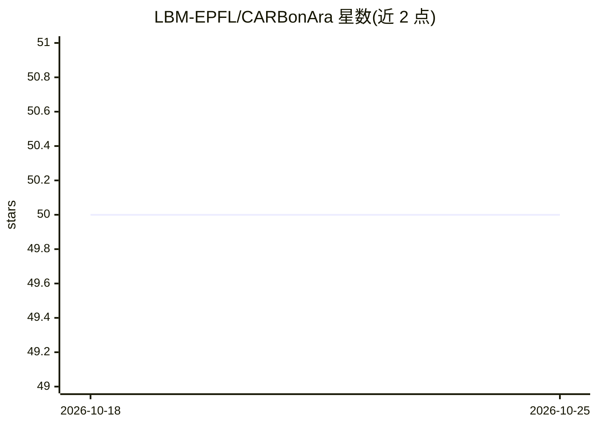

# LBM-EPFL/CARBonAra

⭐ 50 · Jupyter Notebook · NOASSERTION · 推送 2025-11-04 · [GitHub](https://github.com/LBM-EPFL/CARBonAra) · 组织维护

**从蛋白质骨架结构生成序列的几何深度学习框架**

EPFL LBM 实验室开发的蛋白质序列设计框架：基于几何 Transformer，仅以原子坐标与元素为输入，对给定骨架支架生成序列，并可将配体、脂质、离子、水等非蛋白分子环境纳入上下文。提供 imprint 序列采样方法，通过在随机位置注入先验信息调节生成序列的多样性与置信度；支持按链/按位置的部分重设计与忽略特定氨基酸。以 pip/conda 安装的 Python 包形式提供，含命令行工具与 Jupyter 示例，可运行于 CPU 或 CUDA。

## 筛选速览

| 维度 | 判定 | 备注 |
|---|---|---|
| AI 角色 | `ai-native` | 本体是模型或模型工具 |
| 许可风险 | `none` | NOASSERTION |
| 部署形态 | `library` | 以包/库形式分发 |
| 模型依赖 | — | README 未给出锁定关系 |
| 硬件要求 | — | 无带数字的原话,不猜 |
| 安装摩擦 | `medium` | 含编译或系统依赖之一 |
| 成熟度 | — | 结构信号不足 |

## 能力要点

- 几何 Transformer 仅依赖原子坐标与元素，可处理任意骨架支架
- 感知非蛋白分子环境（配体/脂质/离子/水）的上下文序列生成
- imprint 采样在多样性与高置信预测间可调
- 支持部分序列重设计（按链或按位置）与忽略指定氨基酸

## 适用场景

- 给定期望骨架结构设计氨基酸序列
- 在含配体等分子环境中做上下文感知的蛋白质工程
- 对已有蛋白的局部位点做重新设计

## 场景标签

 · 领域:计算生物学/蛋白质设计

## 证据(README 行号)

> L7: CARBonAra is a deep learning framework that facilitates protein sequence design by leveraging atomic coordinates, al
> L11: * **Geometric Transformer**: The framework uses a geometric transformer model based only on atomic coordinates and 

## 星数曲线

2026-10-18 50 → 2026-10-25 50（+0）

---
*卡片 v1 · prompt 1.4 · 生成 2026-10-24 · 置信度 high · 依据 README sha `3220206ed7c4` · [字段定义](../../DATASET.md)*
