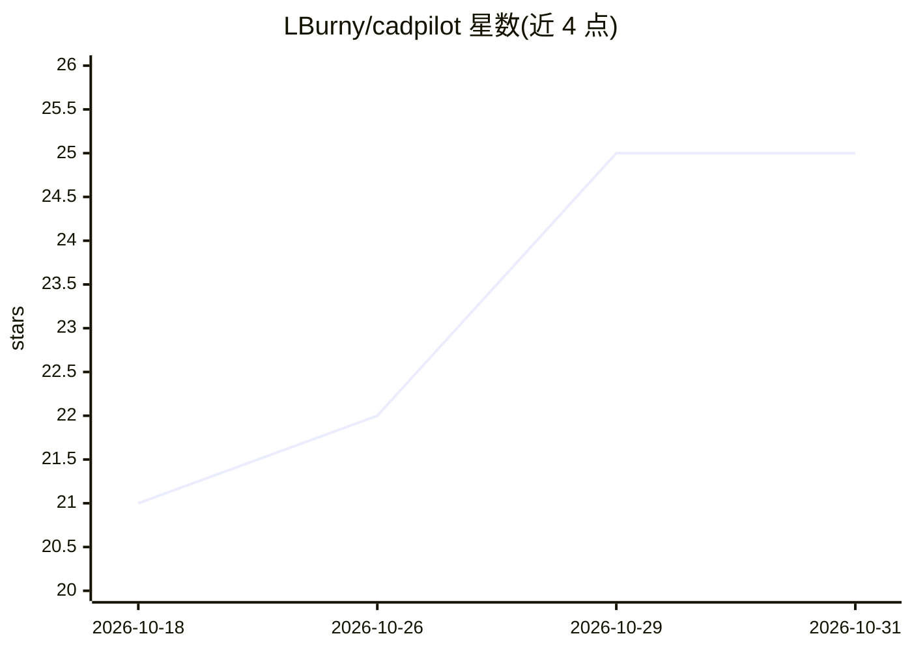

# LBurny/cadpilot

⭐ 25 · Python · MIT · 推送 2026-10-06 · [GitHub](https://github.com/LBurny/cadpilot) · 个人维护 · 中文 README

**让 AI 客户端通过 MCP 操控 FreeCAD 建模的服务器**

CADPilot 由 FreeCAD 插件（XML-RPC 服务端，监听 localhost:9875）与 MCP server（stdio）两层组成，使 Claude Code、Kimi Code、Cherry Studio 等 MCP 客户端以工具调用方式操控 FreeCAD：创建文档、全约束草图、PartDesign 参数化特征、持久关节装配、几何检测（体积/拓扑/干涉）。每步变更有事务日志，可在 Steps 面板中接受/回滚/重放；会话与模式以 JSON 持久化于 ~/.cadpilot/。安装分两步：拷贝插件目录到 FreeCAD、uvx/pip 安装 MCP server，运行需 FreeCAD 本体。

## 筛选速览

| 维度 | 判定 | 备注 |
|---|---|---|
| AI 角色 | `ai-ecosystem` | LLM/agent 周边工具 |
| 许可风险 | `permissive` | MIT |
| 部署形态 | `desktop` | 安装包/桌面程序 |
| 模型依赖 | — | README 未给出锁定关系 |
| 硬件要求 | — | 无带数字的原话,不猜 |
| 安装摩擦 | `low` | 无编译、无系统依赖或容器化 |
| 成熟度 | — | 结构信号不足 |

## 能力要点

- 统一的 cad() 工具覆盖草图/特征/布尔/外观等参数化建模操作
- 步骤日志与审查循环：接受软锁、回滚、重放，execute_code 变更同样事务化
- 几何感知：测量体积/面积、拓扑检查、逐步干涉检测
- diagnose 工具跨平台故障探测，FreeCAD 冻结或未运行时也可用

## 适用场景

- 用对话式 AI 客户端在 FreeCAD 中完成参数化零件与装配建模
- 建模步骤逐步审查、回滚与重放，保证可追溯的建模过程
- 把成功的建模配方存为可复用模式供后续召回

## 场景标签

 · 领域:CAD/工程建模 × AI 工具集成

## 证据(README 行号)

> L5: **AI pilots FreeCAD.** CADPilot is an MCP (Model Context Protocol) server that gives AI clients (Cherry Studio, Clau
> L85: The server speaks MCP on stdio and connects to FreeCAD's XML-RPC addon on `localhost:9875`. You normally don't run 

## 星数曲线

2026-10-18 21 → 2026-10-31 25（+4）

---
*卡片 v1 · prompt 1.4 · 生成 2026-10-28 · 置信度 high · 依据 README sha `4ec6cf75f4bb` · [字段定义](../../DATASET.md)*
