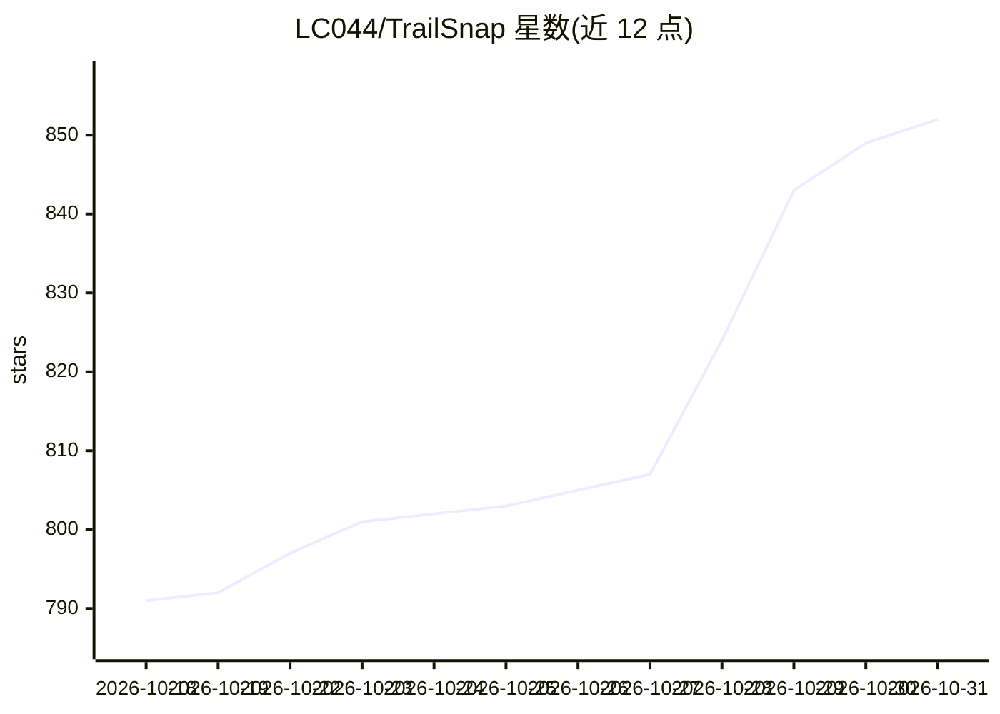

# LC044/TrailSnap

⭐ 852 · Python · AGPL-3.0 · 推送 2026-10-30 · [GitHub](https://github.com/LC044/TrailSnap) · [官网](https://trailsnap.cn/) · 个人维护 · 中文 README

**面向个人与家庭的 AI 相册：自动整理识别旅行与生活照片**

开源相册应用（行影集），面向记录旅行与生活记忆的个人用户：支持足迹地图、人脸识别、场景智能分类、OCR、智能搜索、火车票/行程单/门票信息自动提取、年度出行报告、AI 生成旅行日记与照片描述评分等。可通过 Agent 对话、CLI、MCP 协议及 SKILL 接入 OpenClaw、Claude Code 等平台操作。提供桌面安装包、Docker 一键脚本与源码部署三种方式，数据自托管。部分 AI 能力（自动剪 VLOG、AI 修图）标注为待开发。

## 筛选速览

| 维度 | 判定 | 备注 |
|---|---|---|
| AI 角色 | `ai-enhanced` | 去掉 AI 部分产品仍成立 |
| 许可风险 | `viral` | AGPL-3.0 |
| 部署形态 | `self-host` | docker 或自建部署 |
| 模型依赖 | — | README 未给出锁定关系 |
| 硬件要求 | — | 无带数字的原话,不猜 |
| 安装摩擦 | `low` | 无编译、无系统依赖或容器化 |
| 成熟度 | `idea` | |

## 能力要点

- 人脸识别、场景分类、OCR 与智能搜索的自动照片整理
- 火车票/行程单/门票信息自动识别与年度出行报告生成
- 支持 MCP 协议与 SKILL，可接入 OpenClaw、Claude Code 等平台
- AI 生成旅行日记与照片描述评分，形成电子画廊

## 适用场景

- 把旅行照片自动整理成足迹地图、时间轴与智能相册
- 自动识别票据并生成年度出行统计报告
- 让 AI 生成旅行日记或准备可分享的照片文案
- 自托管相册，本地照片目录作为数据源自动索引

## 场景标签

`人脸识别` `目标检测` `OCR` `AI 写作` · 领域:内容生成

## 证据(README 行号)

> L30: > TrailSnap 是一个智能化的 AI 相册应用，致力于帮助用户轻松记录、整理和回顾自己的出行经历。通过强大的 AI 处理能力，让每一张照片和每一段旅程都成为**值得珍藏的记忆**。
> L46: - **📷 智能相册**: 足迹地图、人物识别、智能分类、OCR识别、智能搜索。

## 星数曲线

2026-10-18 791 → 2026-10-31 852（+61）

---
*卡片 v1 · prompt 1.4 · 生成 2026-10-21 · 置信度 high · 依据 README sha `f2dbc73eede0` · [字段定义](../../DATASET.md)*
