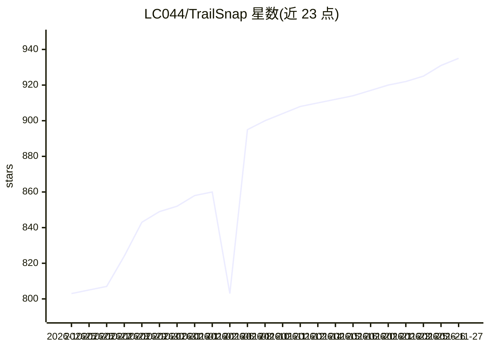

# LC044/TrailSnap

⭐ 935 · Python · AGPL-3.0 · 推送 2026-11-26 · [GitHub](https://github.com/LC044/TrailSnap) · [官网](https://trailsnap.cn/) · 个人维护 · 中文 README

**自托管 AI 相册：整理旅行照片并生成旅行日记**

面向个人与家庭的自托管相册应用，提供照片索引、足迹地图、人脸识别、场景分类、OCR 车票识别与智能搜索等功能；通过接入大模型与 MCP 协议、SKILL 机制（可接入 OpenClaw、Claude Code 等平台）实现对话生成旅行日记与自动任务执行。提供桌面端安装包、Docker 一键脚本/手动部署和源码部署三种安装方式，支持添加外部文件夹作为数据源，部分 AI 能力（自动剪视频、AI 修图）标注为待开发。

## 筛选速览

| 维度 | 判定 | 备注 |
|---|---|---|
| AI 角色 | `ai-native` | 本体是模型或模型工具 |
| 许可风险 | `viral` | AGPL-3.0 |
| 部署形态 | `self-host` | docker 或自建部署 |
| 模型依赖 | — | README 未给出锁定关系 |
| 硬件要求 | — | 无带数字的原话,不猜 |
| 安装摩擦 | `low` | 无编译、无系统依赖或容器化 |
| 成熟度 | — | 结构信号不足 |

## 能力要点

- 火车票/行程单 OCR 识别并自动提取行程信息
- 人脸识别、场景分类与智能搜索
- 支持 MCP 协议与 SKILL，可接入 OpenClaw、Claude Code 等平台
- 自动生成年度出行统计报告

## 适用场景

- 把手机和 NAS 里的旅行照片自动整理成足迹地图与时间轴
- 用一句话让 AI 生成旅行日记和朋友圈文案
- 在本地自托管环境中私有化管理家庭照片
- 统计和回顾一年去过的城市与景区

## 场景标签

`AI 写作` `人脸识别` `OCR` `图像视频处理` · 领域:内容生成

## 证据(README 行号)

> L30: > TrailSnap 是一个智能化的 AI 相册应用，致力于帮助用户轻松记录、整理和回顾自己的出行经历。通过强大的 AI 处理能力，让每一张照片和每一段旅程都成为**值得珍藏的记忆**。
> L58: |**Agent**|√|与AI大模型进行对话，一键生成旅行日记|
> L60: |**SKILL**|√|支持接入OpenClaw、Claude Code等平台，实现自动任务执行|

## 星数曲线

2026-10-25 803 → 2026-11-27 935（+132）

---
*卡片 v1 · prompt 1.4 · 生成 2026-11-24 · 置信度 high · 依据 README sha `48cc53234a75` · [字段定义](../../DATASET.md)*
