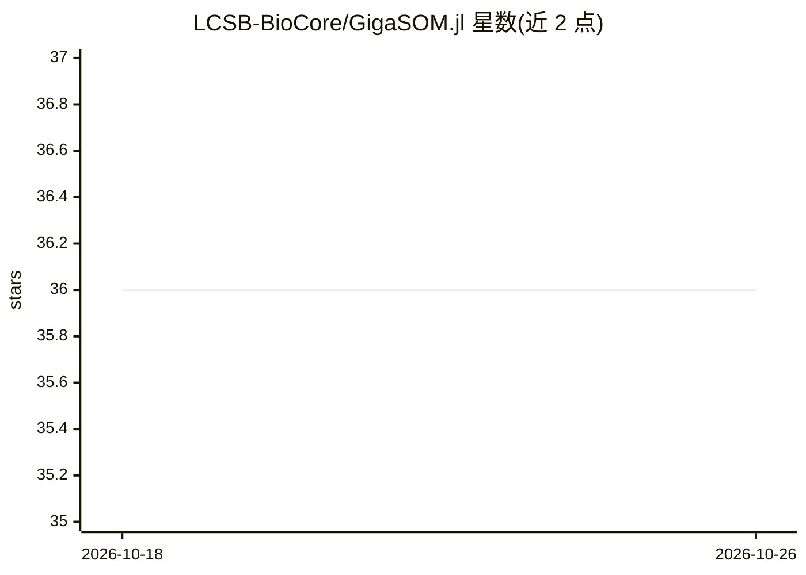

# LCSB-BioCore/GigaSOM.jl

⭐ 36 · Julia · Apache-2.0 · 推送 2025-11-03 · [GitHub](https://github.com/LCSB-BioCore/GigaSOM.jl) · [官网](https://lcsb-biocore.github.io/GigaSOM.jl/) · 组织维护

**面向科研者的 Julia 大规模流式细胞术聚类与可视化工具包**

Julia 语言工具包，用于大规模流式/质谱细胞术数据的聚类与可视化：加载 FCS 文件，执行转换与清洗，运行 FlowSOM 风格的 SOM 聚类，并用 EmbedSOM 生成 2D 投影。分布式并行设计，可在互连多机上处理上亿细胞数据，要求总 RAM 大于数据规模。通过 Julia 包管理器安装，首次加载需数分钟预编译。附带 GigaScience 论文引用格式与配套可视化工具 GigaScatter。

## 筛选速览

| 维度 | 判定 | 备注 |
|---|---|---|
| AI 角色 | `ai-native` | 本体是模型或模型工具 |
| 许可风险 | `permissive` | Apache-2.0 |
| 部署形态 | `None` |  |
| 模型依赖 | — | README 未给出锁定关系 |
| 硬件要求 | — | 无带数字的原话,不猜 |
| 安装摩擦 | `low` | 无编译、无系统依赖或容器化 |
| 成熟度 | — | 结构信号不足 |

## 能力要点

- FlowSOM 风格 SOM 聚类与 EmbedSOM 2D 投影
- 分布式并行处理，支持上亿细胞规模数据集
- FCS 文件加载、转换与清洗操作
- 配套 GigaScatter 可视化输出

## 适用场景

- 对大规模流式细胞术数据做聚类分析
- 生成细胞数据 2D 嵌入并按标记（如 CD4）着色可视化
- 跨多台计算机分布式处理超大细胞数据集

## 场景标签

`科研工具` · 领域:学习与行业

## 证据(README 行号)

> L5: GigaSOM is a Julia toolkit for clustering and visualisation of really large cytometry data. Most generally, it can l
> L13: > Miroslav Kratochvíl, Oliver Hunewald, Laurent Heirendt, Vasco Verissimo, Jiří Vondrášek, Venkata P Satagopam, Rei

## 星数曲线

2026-10-18 36 → 2026-10-26 36（+0）

---
*卡片 v1 · prompt 1.4 · 生成 2026-10-25 · 置信度 high · 依据 README sha `351c8aaffed7` · [字段定义](../../DATASET.md)*
