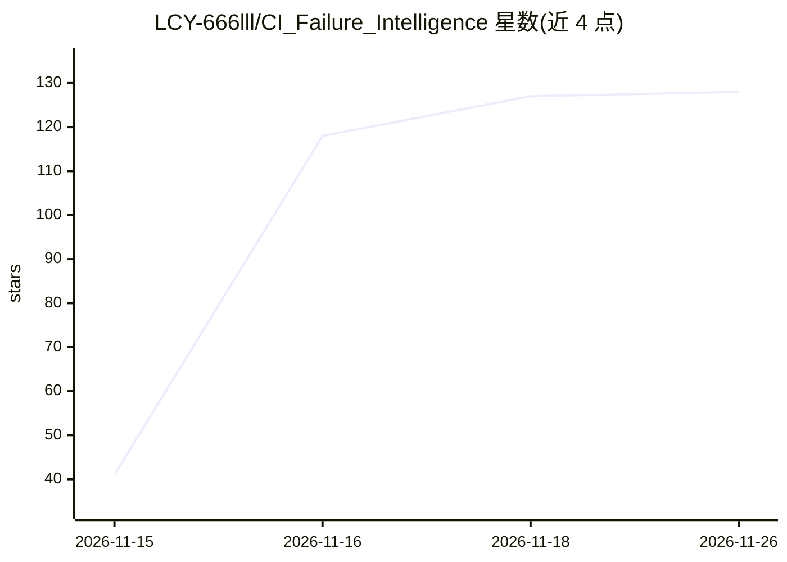

# LCY-666lll/CI_Failure_Intelligence

⭐ 128 · Python · 推送 2026-11-15 · [GitHub](https://github.com/LCY-666lll/CI_Failure_Intelligence) · [官网](https://cifailure.xyz) · 个人维护 · 中文 README

**给研发团队：CI 失败证据检索与 AI 诊断工作台**

面向研发团队的 CI 失败诊断工作台：GitHub Actions 的测试 Job 在失败时投递 JUnit XML，后台解析为失败证据（测试名、错误信息、堆栈），并基于 Qdrant 检索同仓库相似历史；由 LangGraph 编排证据读取、历史检索、缓存与模型调用，生成含结论、可能原因、建议的结构化诊断，引用可跳转回原始失败。通过线上服务 cifailure.xyz 使用，凭据经 GitHub Issues 申请发放，读取已有诊断不触发模型调用、不产生费用；技术栈为 FastAPI + Vue + PostgreSQL/Redis/Qdrant + DeepSeek。

## 筛选速览

| 维度 | 判定 | 备注 |
|---|---|---|
| AI 角色 | `ai-native` | 本体是模型或模型工具 |
| 许可风险 | `none` | — |
| 部署形态 | `None` |  |
| 模型依赖 | — | README 未给出锁定关系 |
| 硬件要求 | — | 无带数字的原话,不猜 |
| 安装摩擦 | `low` | 无编译、无系统依赖或容器化 |
| 成熟度 | — | 结构信号不足 |

## 能力要点

- GitHub Actions 失败时投递 JUnit 报告，自动解析失败证据
- 同仓库相似历史检索，来源事件可跳转核对
- LangGraph 编排证据读取、缓存、模型调用与引用校验
- 诊断按需触发，读取已有结果不产生模型费用

## 适用场景

- 我在排查 CI 失败时，想集中查看错误信息和堆栈
- 想对照同仓库的历史失败判断是否老问题复发
- 想要带证据引用、可核对的 AI 诊断而不是泛泛建议

## 场景标签

`RAG` · 领域:知识与检索

## 证据(README 行号)

> L7: 接收 GitHub Actions 的 JUnit 报告，将失败证据、同仓库相似历史和 AI 诊断放在同一个工作台。诊断中的引用可直接跳转到原始失败，方便核对上下文。
> L89: ### 6. 按需生成 AI 诊断
> L114: Vue 3 / Vite · FastAPI · PostgreSQL · Redis · Qdrant / FastEmbed · LangGraph / LangChain / DeepSeek

## 星数曲线

2026-11-15 41 → 2026-11-26 128（+87）

---
*卡片 v1 · prompt 1.4 · 生成 2026-11-17 · 置信度 high · 依据 README sha `1ece64ae566f` · [字段定义](../../DATASET.md)*
