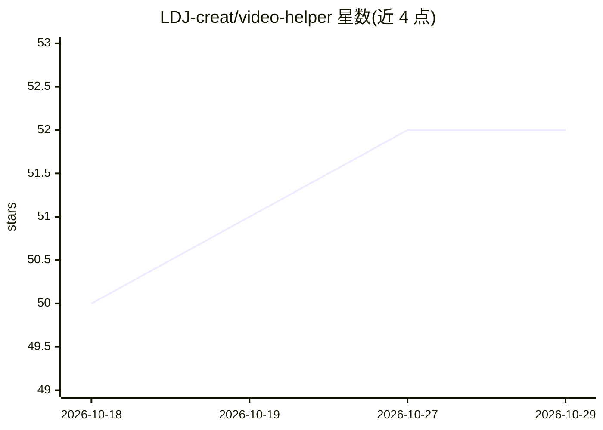

# LDJ-creat/video-helper

⭐ 52 · Python · NOASSERTION · 推送 2026-07-14 · [GitHub](https://github.com/LDJ-creat/video-helper) · [官网](https://video-helper-landing.vercel.app/) · 个人维护 · 中文 README

**AI 视频学习助手：从视频链接/本地视频自动生成思维导图与总结**

全栈 Monorepo 应用（Next.js 前端 + FastAPI 后端 + Electron 桌面端）：用户提供 B站/YouTube/抖音链接或本地视频，系统经下载、音频转录、内容抽取与 LLM 分析生成思维导图、要点总结与笔记；支持图节点→内容→视频时间戳双向跳转、基于视频上下文的多轮问答与 AI 生成练习题。转录默认本地 faster-whisper，可配置云端 ASR（DashScope/OpenAI/火山引擎）加速；长视频用 MapReduce 策略分段并发分析。提供桌面安装包、Docker 与源码三种部署方式。

## 筛选速览

| 维度 | 判定 | 备注 |
|---|---|---|
| AI 角色 | `ai-native` | 本体是模型或模型工具 |
| 许可风险 | `none` | NOASSERTION |
| 部署形态 | `desktop` | 安装包/桌面程序 |
| 模型依赖 | — | README 未给出锁定关系 |
| 硬件要求 | — | 无带数字的原话,不猜 |
| 安装摩擦 | `low` | 无编译、无系统依赖或容器化 |
| 成熟度 | — | 结构信号不足 |

## 能力要点

- 自动流水线：下载→转录→LLM 分析生成思维导图与总结
- 思维导图节点与内容模块、视频时间戳双向跳转
- 本地 faster-whisper 开箱即用，云端 ASR 可选加速
- AI 多轮问答与基于视频知识点的练习题生成

## 适用场景

- 看长视频课程时自动生成思维导图和笔记
- 通过点击总结要点快速跳到视频对应片段复习
- 基于视频内容提问并生成练习题检验学习效果
- 分析播客或本地视频并建立可检索的学习资料

## 场景标签

`知识库管理` · 领域:知识与检索

## 证据(README 行号)

> L18: This project adopts a full-stack Monorepo architecture and integrates advanced **LLM analysis pipelines**. Users si
> L26: - **Smart Pipeline Analysis**: Automated handling of video downloading, audio transcription, content extraction, an
> L31: - **AI Q&A**: Supports multi-turn dialogue with the user based on video context, explaining difficult points in dep

## 星数曲线

2026-10-18 50 → 2026-10-29 52（+2）

---
*卡片 v1 · prompt 1.4 · 生成 2026-10-24 · 置信度 mid · 依据 README sha `a01ed6426e41` · [字段定义](../../DATASET.md)*
