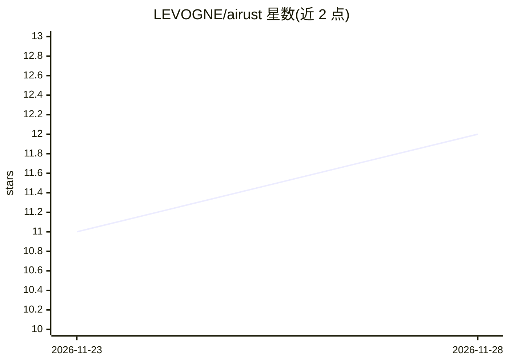

# LEVOGNE/airust

⭐ 12 · Rust · MIT · 推送 2026-11-27 · [GitHub](https://github.com/LEVOGNE/airust) · [官网](https://docs.rs/airust) · 个人维护

**Rust 模块化知识检索库：词法搜索、文本匹配、可选语义检索**

AIRust 是一个 Rust 库，输入带 ID、文本与可选元数据的条目，提供 BM25/TF-IDF 词法搜索、文本匹配、可选语义检索与重排、PDF 文本导入与段落证据、引用校验等功能。面向需要在自己应用中实现检索与知识比较的开发者，可选提供本地 MCP 只读工具供 agent 访问知识。发布说明给出各版本的实测延迟、内存与回归数据，并明确声明混合检索相对 SQLite FTS5 未显示回答质量优势。通过 Cargo 分发，要求 Rust 1.89/1.92。

## 筛选速览

| 维度 | 判定 | 备注 |
|---|---|---|
| AI 角色 | `ai-ecosystem` | LLM/agent 周边工具 |
| 许可风险 | `permissive` | MIT |
| 部署形态 | `self-host` | docker 或自建部署 |
| 模型依赖 | — | README 未给出锁定关系 |
| 硬件要求 | — | 无带数字的原话,不猜 |
| 安装摩擦 | `low` | 无编译、无系统依赖或容器化 |
| 成熟度 | — | 结构信号不足 |

## 能力要点

- 提供 BM25、TF-IDF 词法检索与可选语义检索、重排
- 支持 PDF 文本提取、段落证据与引用/出处校验
- 可选本地 MCP 只读工具，带进度、取消与结构化 schema
- README 记录各版本延迟、内存、分配等实测数据与局限

## 适用场景

- 在自己的 Rust 应用中实现知识库检索与文本匹配
- 通过 MCP 让 agent 以受控只读方式查询本地知识
- 将 PDF 文档导入为带出处与版本绑定的可检索知识

## 场景标签

`RAG` `语义搜索` `文档解析` · 领域:知识与检索

## 证据(README 行号)

> L5: AIRust is a Rust library for finding information, comparing text, and suggesting possible connections. Give it entri
> L27: |0.4.1|Optional local MCP with read-only tools, exact citations, progress and cancellation.|Give agents bounded acc

## 星数曲线

2026-11-23 11 → 2026-11-28 12（+1）

---
*卡片 v1 · prompt 1.4 · 生成 2026-11-23 · 置信度 low · 依据 README sha `df04aab30acb` · [字段定义](../../DATASET.md)*
