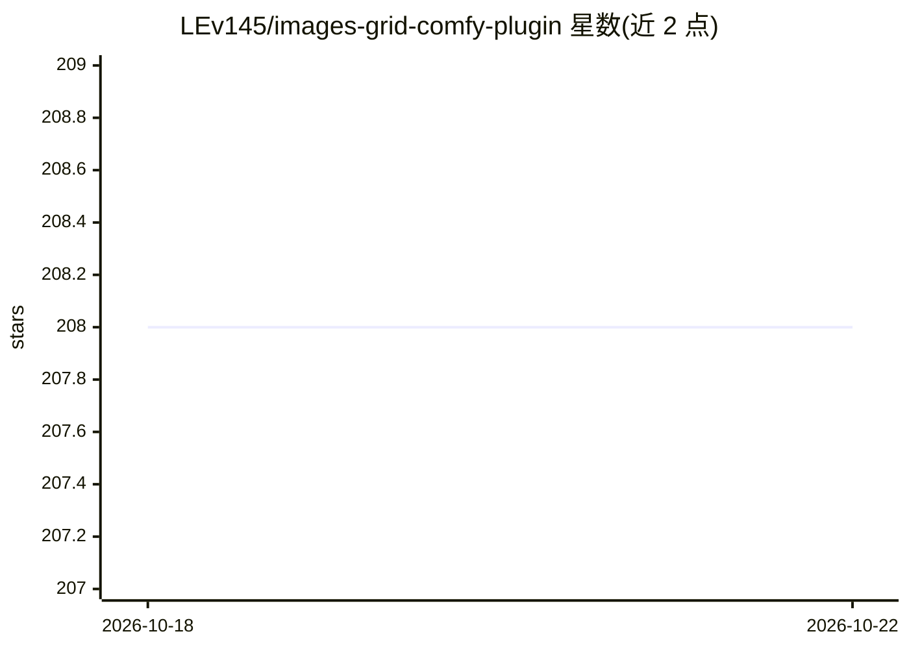

# LEv145/images-grid-comfy-plugin

⭐ 208 · Python · 推送 2026-09-17 · [GitHub](https://github.com/LEv145/images-grid-comfy-plugin) · [官网](https://civitai.com/models/31126) · 个人维护

**ComfyUI 的图像网格/X/Y Plot 对比节点插件**

ComfyUI 的自定义节点插件，用于生成图像网格与类似 auto1111 的 X/Y/Z Plot 对比图，提供比 auto1111 更多的设置项，并支持与 efficiency 节点集成。安装方式为下载 zip 解压到 custom_nodes 目录。仓库附带示例 workflow 文件。面向使用 ComfyUI 进行 Stable Diffusion 生图的用户。

## 筛选速览

| 维度 | 判定 | 备注 |
|---|---|---|
| AI 角色 | `ai-ecosystem` | LLM/agent 周边工具 |
| 许可风险 | `none` | — |
| 部署形态 | `None` |  |
| 模型依赖 | — | README 未给出锁定关系 |
| 硬件要求 | — | 无带数字的原话,不猜 |
| 安装摩擦 | `low` | 无编译、无系统依赖或容器化 |
| 成熟度 | — | 结构信号不足 |

## 能力要点

- 生成图像网格与 X/Y/Z Plot 对比图
- 提供比 auto1111 更多的 XYZ Plot 设置项
- 支持与 efficiency 节点集成
- 仓库附带示例 workflow

## 适用场景

- 在 ComfyUI 中对比不同参数下的出图效果
- 批量生成参数网格实验图
- 配合 efficiency 节点做效率工作流对比

## 场景标签

`图像生成` · 领域:内容生成

## 证据(README 行号)

> L1: # ImagesGrid: Comfy plugin
> L11: ### XYZPlot, like in auto1111, but with more settings

## 星数曲线

2026-10-18 208 → 2026-10-22 208（+0）

---
*卡片 v1 · prompt 1.4 · 生成 2026-10-22 · 置信度 mid · 依据 README sha `f8897aa1bca1` · [字段定义](../../DATASET.md)*
