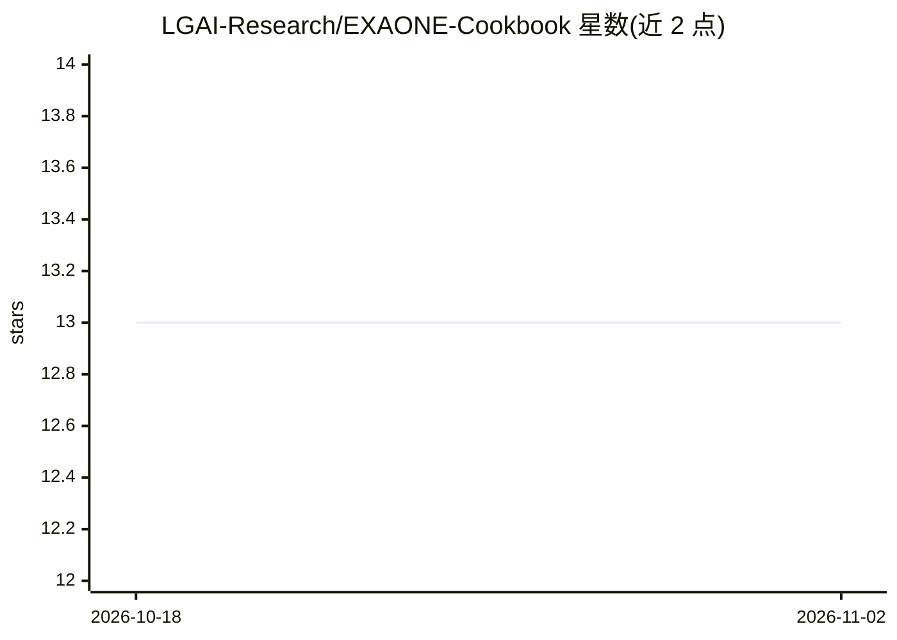

# LGAI-Research/EXAONE-Cookbook

⭐ 13 · Python · NOASSERTION · 推送 2026-10-02 · [GitHub](https://github.com/LGAI-Research/EXAONE-Cookbook) · [官网](https://www.lgresearch.ai/) · 组织维护

**EXAONE 模型 Agent 开发教程与配套库的一站式 Cookbook**

LG AI Research 维护的开源 Cookbook：以 Track 00–10 的 Jupyter 笔记本讲解 K-EXAONE / K-EXAONE 1.0 (236B) / EXAONE 模型的 Agent 用法（agent loop、MCP、RAG、memory、safety、评测），并随仓库提供 `exaone/` Python 库（LLM/agent/RAG/memory/observability）、`eval/` 基准（默认 BFCL 4 套件、M1–M10 矩阵）、RAG 基础设施脚本与连接外部 Agent 框架（如 smolagents）的 Proof Gallery。Track 00–01 仅需 API key 即可运行，无需 Postgres 或 Docker；RAG 基础设施通过 Docker 脚本搭建。需 Python 3.12+，模型权重与 API 遵循 LG AI Research 另行条款。

## 筛选速览

| 维度 | 判定 | 备注 |
|---|---|---|
| AI 角色 | `ai-ecosystem` | LLM/agent 周边工具 |
| 许可风险 | `none` | NOASSERTION |
| 部署形态 | `library` | 以包/库形式分发 |
| 模型依赖 | — | README 未给出锁定关系 |
| 硬件要求 | — | 无带数字的原话,不猜 |
| 安装摩擦 | `low` | 无编译、无系统依赖或容器化 |
| 成熟度 | — | 结构信号不足 |

## 能力要点

- Track 00–10 Jupyter 教程覆盖 Agent loop、MCP、RAG、memory、safety
- 随附 `exaone/` 库：LLM、agents、RAG、memory、observability
- `eval/` 基准工具，默认跑 BFCL 4 套件，含 M1–M10 矩阵参考分数
- Proof Gallery 将 EXAONE 接入 smolagents 等外部 Agent 框架

## 适用场景

- 按 Track 逐步学习用 EXAONE 构建带工具调用与 RAG 的 Agent
- 复用现成基准脚本评测 Agent 的工具调用表现
- 参照 RAG 基础设施脚本搭建本地检索环境

## 场景标签

`教程课程` `Agent 框架` `RAG` `模型评测` · 领域:Agent 开发

## 证据(README 行号)

> L3: An open-source cookbook for using K-EXAONE / K-EXAONE 1.0 (236B) / EXAONE models as **agents**.
> L4: This repository provides Jupyter recipes (Track 00–10), the `exaone/` library, RAG infrastructure, benchmarks (`eval
> L47: ├── exaone/            # LLM · agents · RAG · memory · observability library

## 星数曲线

2026-10-18 13 → 2026-11-02 13（+0）

---
*卡片 v1 · prompt 1.4 · 生成 2026-10-31 · 置信度 high · 依据 README sha `2dc60793e9a1` · [字段定义](../../DATASET.md)*
