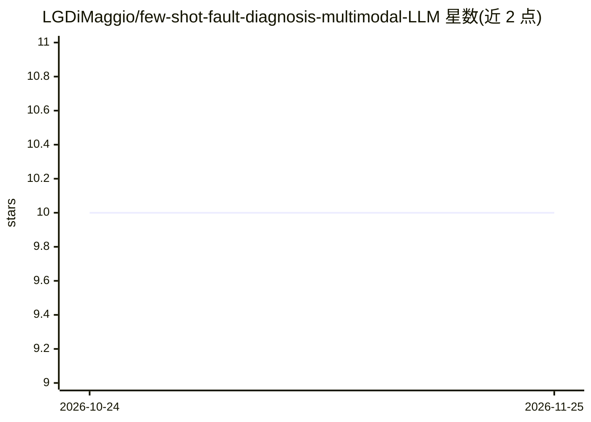

# LGDiMaggio/few-shot-fault-diagnosis-multimodal-LLM

⭐ 10 · Python · MIT · 推送 2026-01-27 · [GitHub](https://github.com/LGDiMaggio/few-shot-fault-diagnosis-multimodal-LLM) · 个人维护

**科研：少样本轴承故障诊断的多模态 LLM 实现**

论文官方实现：将振动信号经包络分析与连续小波变换转为 300x300 CWT 图像，用多模态大模型（GPT-4o、GPT-5.1、Claude 4.5 Haiku/Sonnet、本地 LLaVA-1.5-7B）与原型网络基线（ResNet-50/Swin V2-T）做 4 类轴承健康状态的 1/5/10-shot 分类，10 次重复评估并输出 t-Student 95% 置信区间与 Excel 结果。需用户自备振动数据并自行生成 CWT 图像；LLaVA 本地推理需 GPU，云端模型需配置 API key。

## 筛选速览

| 维度 | 判定 | 备注 |
|---|---|---|
| AI 角色 | `ai-native` | 本体是模型或模型工具 |
| 许可风险 | `permissive` | MIT |
| 部署形态 | `None` |  |
| 模型依赖 | locked-api |  |
| 硬件要求 | — | 无带数字的原话,不猜 |
| 安装摩擦 | `low` | 无编译、无系统依赖或容器化 |
| 成熟度 | `idea` | |

## 能力要点

- 振动信号 CWT 图像 + 多模态 LLM 少样本分类（1/5/10-shot）
- 原型网络基线：ResNet-50 / Swin Transformer V2-T 骨干 + easyfsl
- 10 次重复评估，输出 Accuracy/Precision/Recall/F1 与 95% CI 至 Excel
- 通过 config.yaml 自定义 shot 配置、prompt 风格与启用模型

## 适用场景

- 复现论文中的少样本轴承故障诊断实验
- 在自己的轴承振动数据上评估多模态 LLM 诊断效果
- 与原型网络基线对比 MLLM 的少样本分类表现

## 场景标签

`科研工具` `多模态` · 领域:学习与行业

## 证据(README 行号)

> L8: This repository provides the official implementation for few-shot learning-based bearing fault diagnosis using:
> L10: 1. **Multimodal Large Language Models (MLLMs)**:
> L22: ### Problem Setup

## 星数曲线

2026-10-24 10 → 2026-11-25 10（+0）

---
*卡片 v1 · prompt 1.4 · 生成 2026-11-20 · 置信度 high · 依据 README sha `2ffb98ad72bb` · [字段定义](../../DATASET.md)*
