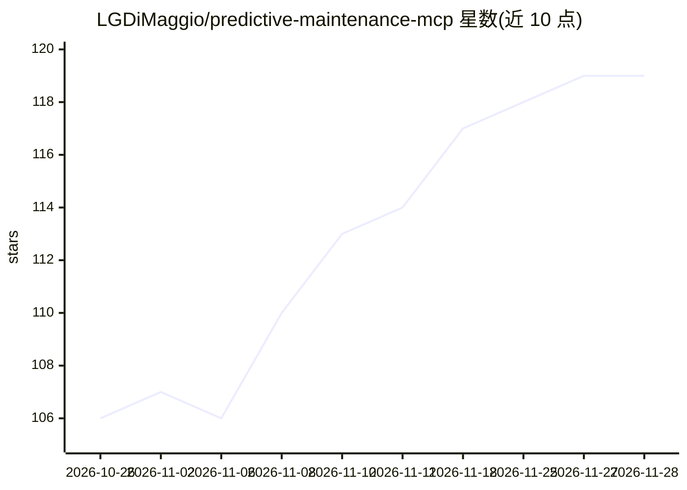

# LGDiMaggio/predictive-maintenance-mcp

⭐ 119 · Python · MIT · 推送 2026-11-27 · [GitHub](https://github.com/LGDiMaggio/predictive-maintenance-mcp) · [官网](https://lgdimaggio.github.io/predictive-maintenance-mcp/) · 个人维护

**给可靠性工程师提供振动诊断能力的 MCP 服务器**

面向可靠性/维护工程师的 MCP 服务器，将振动信号分析接入 AI 助手：提供 48 个本地运行的 MCP 端点（44 工具+4 提示词），覆盖包络谱故障频率匹配、ISO 20816-3 严重度分级、异常检测模型训练与资产健康台账。核心设计为「不猜测」——故障判定须有谱证据支撑，报告措辞由服务器而非模型生成。支持 Claude Desktop/Claude Code 插件（9 技能），生成 HTML/Word 报告，原始数据不出本地。需 Python 3.11+、uv 与 MCP 客户端。

## 筛选速览

| 维度 | 判定 | 备注 |
|---|---|---|
| AI 角色 | `ai-ecosystem` | LLM/agent 周边工具 |
| 许可风险 | `permissive` | MIT |
| 部署形态 | `library` | 以包/库形式分发 |
| 模型依赖 | local-ok | 支持本地模型 |
| 硬件要求 | — | 无带数字的原话,不猜 |
| 安装摩擦 | `low` | 无编译、无系统依赖或容器化 |
| 成熟度 | — | 结构信号不足 |

## 能力要点

- 48 个本地 MCP 端点，信号以 signal_id 句柄从加载贯通到报告
- 故障判定要求谱证据匹配，严重度引用 ISO 20816-3，措辞由服务器撰写
- 附带可复现的 CWRU 轴承基准测试（CI 守护、盲测协议）
- 提供 Claude Code 插件，含 9 个自动激活的诊断技能

## 适用场景

- 用自然语言对轴承振动信号做故障检测与严重度评估
- 在健康基线数据上训练异常检测模型并标记离群信号
- 生成含频谱图表与 ISO 分级的交互式诊断报告
- 跟踪设备自基线以来各指标的变化

## 场景标签

 · 领域:工业物联网/预测性维护

## 证据(README 行号)

> L14: An open-source MCP server that turns LLMs into condition monitoring assistants for reliability engineers. Its core 
> L36: The AI doesn't guess: it calls **48 specialized MCP endpoints** (44 tools + 4 prompts) running locally on your mach
> L174: - **LLM-agnostic** — works with Claude, ChatGPT, Microsoft Copilot Studio, or any MCP-compatible client. Use Ollam

## 星数曲线

2026-10-26 106 → 2026-11-28 119（+13）

---
*卡片 v1 · prompt 1.4 · 生成 2026-11-28 · 置信度 high · 依据 README sha `e8ae5b53bf5e` · [字段定义](../../DATASET.md)*
