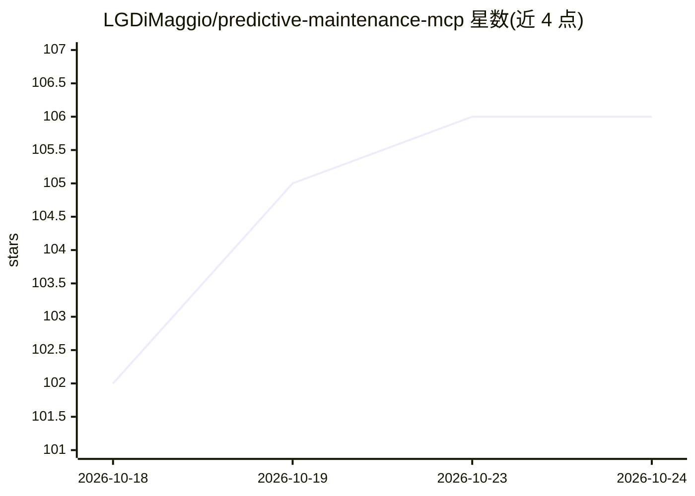

# LGDiMaggio/predictive-maintenance-mcp

⭐ 106 · Python · NOASSERTION · 推送 2026-10-24 · [GitHub](https://github.com/LGDiMaggio/predictive-maintenance-mcp) · [官网](https://lgdimaggio.github.io/predictive-maintenance-mcp/) · 个人维护

**面向可靠性工程师的振动诊断 MCP 服务器**

开源 Python MCP 服务器，把 LLM 变成设备状态监测助手：提供 41 个本地运行的 MCP 端点（38 工具+3 提示词），覆盖频谱分析、轴承故障频率匹配、ISO 20816-3 严重度评估、交互式 HTML 报告生成、异常检测训练与设备健康台账。设计规则为不做臆测：故障判定要求谱证据匹配，报告措辞由服务器生成。另以 Claude Code 插件形式提供 8 个诊断技能、2 个 agent 与 3 个命令。数据不离开本地基础设施，支持任意 MCP 客户端。

## 筛选速览

| 维度 | 判定 | 备注 |
|---|---|---|
| AI 角色 | `ai-ecosystem` | LLM/agent 周边工具 |
| 许可风险 | `permissive` | NOASSERTION |
| 部署形态 | `library` | 以包/库形式分发 |
| 模型依赖 | local-ok | 支持本地模型 |
| 硬件要求 | — | 无带数字的原话,不猜 |
| 安装摩擦 | `low` | 无编译、无系统依赖或容器化 |
| 成熟度 | — | 结构信号不足 |

## 能力要点

- 41 个 MCP 端点（38 工具+3 提示词）本地运行振动诊断
- 故障判定要求谱证据匹配，严重度引用 ISO 20816-3，服务器拒绝臆测
- 附 Claude Code 插件：8 技能、2 agent、3 命令
- CWRU 数据集盲测基准，结果绑定可复现工件并由 CI 防漂移

## 适用场景

- 用自然语言对轴承振动信号做故障检测与严重度评估
- 从设备手册提取轴承型号并核对实测故障频率
- 在健康基线上训练异常检测器并跟踪设备状态变化

## 场景标签

 · 领域:工业设备/预测性维护

## 证据(README 行号)

> L10: LGDiMaggio/predictive-maintenance-mcp MCP server
> L42: The AI doesn't guess: it calls **41 specialized MCP endpoints** (38 tools + 3 prompts) running locally on your mach
> L179: - **LLM-agnostic** — works with Claude, ChatGPT, Microsoft Copilot Studio, or any MCP-compatible client. Use Ollam

## 星数曲线

2026-10-18 102 → 2026-10-24 106（+4）

---
*卡片 v1 · prompt 1.4 · 生成 2026-10-23 · 置信度 mid · 依据 README sha `888c3916c08a` · [字段定义](../../DATASET.md)*
