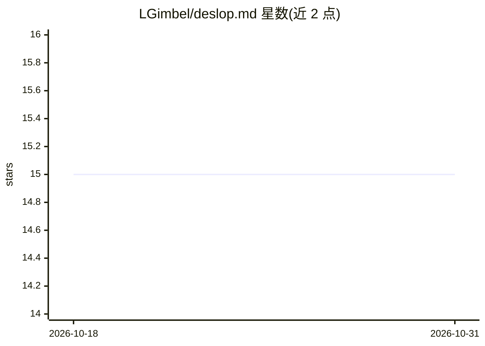

# LGimbel/deslop.md

⭐ 15 · Python · MIT · 推送 2026-03-21 · [GitHub](https://github.com/LGimbel/deslop.md) · 个人维护

**修复 LLM 生成的 ASCII 框图的 CLI 工具，对齐边框与内容**

命令行 Python 脚本，处理 LLM 生成的 ASCII 框线图（架构图等）：当文本溢出边框、竖线与角标错位、嵌套框宽窄不一时，自动扩宽边框、补齐内容行填充、递归传播嵌套框宽度变化，并对齐竖线与箭头字符。支持从文件或 stdin 管道输入，可经 curl 直接运行远程脚本，无需安装。面向需要清理 LLM 输出文档的开发者。

## 筛选速览

| 维度 | 判定 | 备注 |
|---|---|---|
| AI 角色 | `ai-ecosystem` | LLM/agent 周边工具 |
| 许可风险 | `permissive` | MIT |
| 部署形态 | `None` |  |
| 模型依赖 | — | README 未给出锁定关系 |
| 硬件要求 | — | 无带数字的原话,不猜 |
| 安装摩擦 | `low` | 无编译、无系统依赖或容器化 |
| 成熟度 | — | 结构信号不足 |

## 能力要点

- 边框按内容自动扩宽，竖线与角标对齐
- 嵌套框宽度变化在父/子层级间传播
- 支持 ┌┐└┘│─├┤┬┴▼ 等框线字符
- 支持文件参数与 stdin 管道两种输入方式

## 适用场景

- 清理 LLM 生成的架构图中错位的边框与竖线
- 批量修复文档中溢出边框的 ASCII 图表

## 场景标签

 · 领域:开发工具/文本处理

## 证据(README 行号)

> L9: A CLI tool that fixes broken ASCII box-drawing diagrams — the kind LLMs love to generate but can never quite get rig
> L11: When ChatGPT, Claude, or any other LLM spits out an architecture diagram with misaligned borders, overlapping pipes

## 星数曲线

2026-10-18 15 → 2026-10-31 15（+0）

---
*卡片 v1 · prompt 1.4 · 生成 2026-10-31 · 置信度 high · 依据 README sha `7c811c95b7e3` · [字段定义](../../DATASET.md)*
