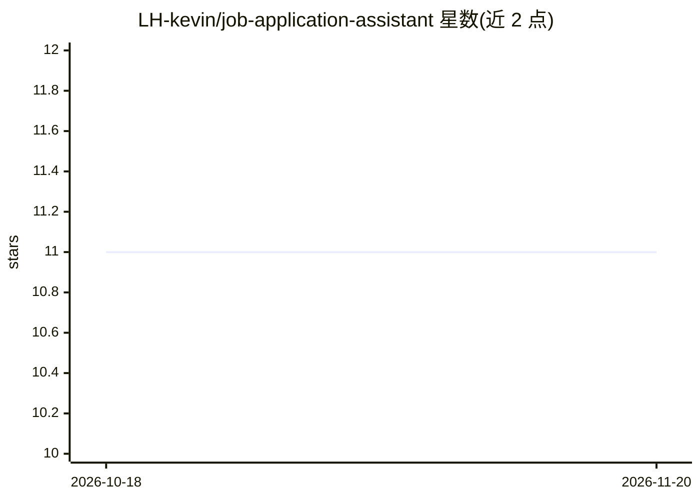

# LH-kevin/job-application-assistant

⭐ 11 · Python · MIT · 推送 2026-09-12 · [GitHub](https://github.com/LH-kevin/job-application-assistant) · 个人维护 · 中文 README

**个人求职者的 Claude/Codex Skill：找岗、背调、投递追踪**

以 Claude Skill 形式组织的个人求职工具，按「找岗位→目标公司背调→辅助填写 ATS 表单→统一追踪投递」的流程推进：按关键词寻找招聘公司并定位官方招聘页，汇总财务、法律、员工口碑等公开信息生成背调报告，用可见浏览器协助填写 Greenhouse/Lever/Workday 表单，投递记录存于本机 JSON 并生成静态 HTML 看板。无服务器、无账号、无云同步，每次真实提交需人工确认，遇 CAPTCHA 停止交还控制权。追踪与报告脚本仅依赖 Python 标准库，表单辅助需 Playwright 与 Chromium。

## 筛选速览

| 维度 | 判定 | 备注 |
|---|---|---|
| AI 角色 | `ai-native` | 本体是模型或模型工具 |
| 许可风险 | `permissive` | MIT |
| 部署形态 | `library` | 以包/库形式分发 |
| 模型依赖 | locked-api |  |
| 硬件要求 | — | 无带数字的原话,不猜 |
| 安装摩擦 | `low` | 无编译、无系统依赖或容器化 |
| 成熟度 | — | 结构信号不足 |

## 能力要点

- 投递前生成公司背调报告（财务/法律/口碑等公开信息）
- 可见浏览器辅助填写 Greenhouse、Lever、Workday 等 ATS 表单
- 投递记录集中看板与重复投递检查，数据存本机 JSON
- 每次真实提交需人工确认，不自动提交、不绕过验证码

## 适用场景

- 找工作前先对公司做背景调查再决定是否投递
- 集中记录和跟进所有投递进度、避免重复申请
- 借助浏览器自动化协助填写招聘网站的申请表单

## 场景标签

`浏览器自动化` · 领域:效率与自动化

## 证据(README 行号)

> L3: **个人求职 AI Skill｜适用于 Claude / Codex**
> L9: > **一句话看懂：** 让 AI 帮你**发现目标公司 → 投递前做背调 → 谨慎协助填写申请表 → 统一追踪所有投递**，而真正的提交始终由你本人确认。
> L11: 这是一个给**个人求职者**使用的 Claude / Codex Skill，不是招聘 SaaS。

## 星数曲线

2026-10-18 11 → 2026-11-20 11（+0）

---
*卡片 v1 · prompt 1.4 · 生成 2026-11-19 · 置信度 mid · 依据 README sha `8f24dfc9bd7f` · [字段定义](../../DATASET.md)*
