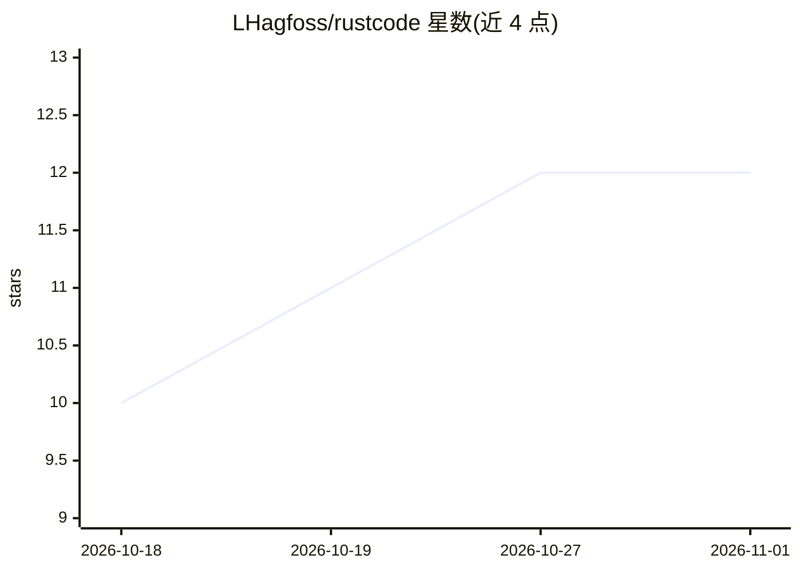

# LHagfoss/rustcode

⭐ 12 · Rust · Apache-2.0 · 推送 2026-10-31 · [GitHub](https://github.com/LHagfoss/rustcode) · [官网](rustcode.lhagfoss.com) · 个人维护

**Rust 编写的终端 AI 编码 agent，多模型接入与工具沙箱**

基于 Rust 的轻量终端（TUI）编码 agent harness，提供文件编辑、shell 命令与搜索等带审批和可选 OS 沙箱的工具能力，支持子 agent 委派、后台任务、MCP 服务器与 Markdown 技能。可连接 Ollama、任意 OpenAI 兼容 API，或复用 ChatGPT、GitHub Copilot、Claude 订阅登录；也能以 ACP 服务器形式接入编辑器，另有 macOS 桌面端与 iPhone 远程会话。项目始于测试 Apple 设备端 Foundation Models，该路径需 macOS 27/Xcode 27 且上下文约 2k，作者注明不建议用于实际工作。

## 筛选速览

| 维度 | 判定 | 备注 |
|---|---|---|
| AI 角色 | `ai-ecosystem` | LLM/agent 周边工具 |
| 许可风险 | `permissive` | Apache-2.0 |
| 部署形态 | `library` | 以包/库形式分发 |
| 模型依赖 | local-ok | 支持本地模型 |
| 硬件要求 | — | 无带数字的原话,不猜 |
| 安装摩擦 | `low` | 无编译、无系统依赖或容器化 |
| 成熟度 | — | 结构信号不足 |

## 能力要点

- 支持 Ollama、OpenAI 兼容端点及 ChatGPT/Copilot/Claude 订阅登录，per-model profile 统一配置
- 工具调用带一次性/可复用审批与 macOS/Linux 可选 OS 沙箱
- 子 agent 委派、后台任务、MCP 服务器与 Markdown 技能目录
- 可作为 ACP 服务器无头运行，支持 iPhone 远程会话

## 适用场景

- 在终端里让 AI agent 执行测试、改代码等开发任务
- 复用已有的 ChatGPT/Copilot/Claude 订阅或本地 Ollama 模型
- 通过 ACP 协议把编码 agent 接入编辑器

## 场景标签

`编码 Agent` · 领域:编码与开发

## 证据(README 行号)

> L21: `rustcode` is a lightweight terminal (TUI) coding agent. It started as a way to
> L85: - **Any model** — Ollama, OpenAI-compatible endpoints, the Responses API and

## 星数曲线

2026-10-18 10 → 2026-11-01 12（+2）

---
*卡片 v1 · prompt 1.4 · 生成 2026-11-01 · 置信度 high · 依据 README sha `ad65b4e8cf2b` · [字段定义](../../DATASET.md)*
