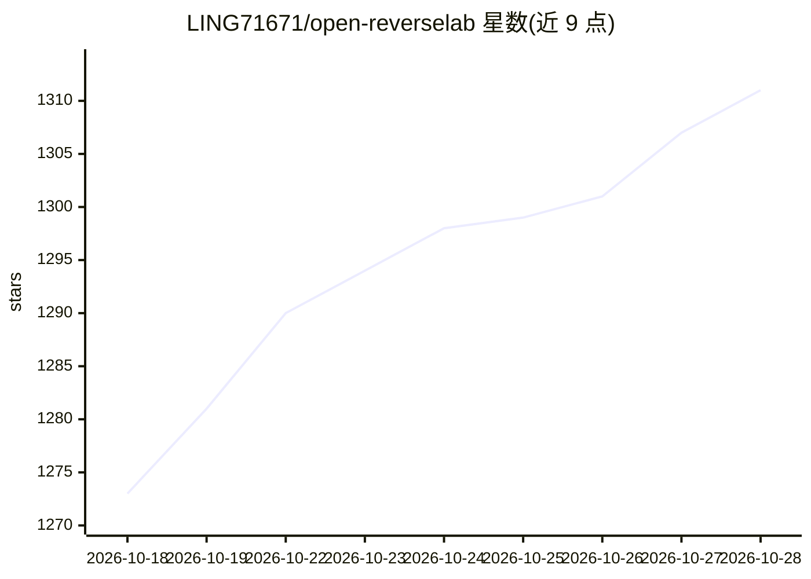

# LING71671/open-reverselab

⭐ 1,311 · Python · GPL-3.0 · 推送 2026-10-21 · [GitHub](https://github.com/LING71671/open-reverselab) · 个人维护 · 中文 README

**面向逆向工程的可运行知识库与 MCP 工具平台（100+ 工具）**

面向逆向工程师、安全研究者、CTF 选手与 AI Agent 的开源逆向工程实验室：以 5 个板块（Web CTF、APK 逆向、PE 逆向、通用、misc）组织 180+ 篇按『场景→输入信号→方法→攻击链→MCP 工具映射』结构化的文章，并通过 reverse_lab_tools MCP 服务器暴露 100+ 工具（ghidra、frida、rizin、yara、triage 等），可被 Claude Code、Codex 或任意 MCP 兼容 Agent 调用。采用目录即约定（samples/exports/patches/kb/reports）管理工作产物，提供 START_HERE 脚本做首次运行检查、分板块按需安装工具链、MCP 冒烟测试与环境快照协议。GPL-3.0-only 许可，附完整免责声明与 AI/ML 训练保护条款。

## 筛选速览

| 维度 | 判定 | 备注 |
|---|---|---|
| AI 角色 | `ai-ecosystem` | LLM/agent 周边工具 |
| 许可风险 | `viral` | GPL-3.0 |
| 部署形态 | `None` |  |
| 模型依赖 | — | README 未给出锁定关系 |
| 硬件要求 | — | 无带数字的原话,不猜 |
| 安装摩擦 | `low` | 无编译、无系统依赖或容器化 |
| 成熟度 | — | 结构信号不足 |

## 能力要点

- 180+ 篇『场景→输入信号→方法→攻击链→MCP 工具映射』结构化文章，覆盖 5 个板块
- reverse_lab_tools MCP 服务器暴露 100+ 工具（ghidra/frida/rizin/yara/triage 等）
- START_HERE 脚本做首次运行检查并生成 MCP 冒烟报告
- 分板块按需安装工具链（CTF/Android/Windows/Common）

## 适用场景

- CTF 选手按入口信号（URL/APK/PE）查攻击链并调用对应 MCP 工具
- 安全研究者用 sample_full_workup 对样本做自动化分类分析
- AI Agent 开发者接入 100+ 逆向工程工具搭建自动化分析流程

## 场景标签

`网络安全` `教程课程` · 领域:学习与行业

## 证据(README 行号)

> L3: **Open-source AI-powered reverse-engineering platform for autonomous binary analysis, built for Claude Code, Codex, 
> L31: - **100+ MCP tools** exposed through `reverse_lab_tools` — curl, frida, ghidra, rizin, yara, triage, kb_router, … a
> L43: |An **AI Agent** developer wiring up reverse-engineering tools|For AI Agents — context chain, MCP smoke test, env s

## 星数曲线

2026-10-18 1,273 → 2026-10-28 1,311（+38）

---
*卡片 v1 · prompt 1.4 · 生成 2026-10-21 · 置信度 high · 依据 README sha `ad407202a9bb` · [字段定义](../../DATASET.md)*
