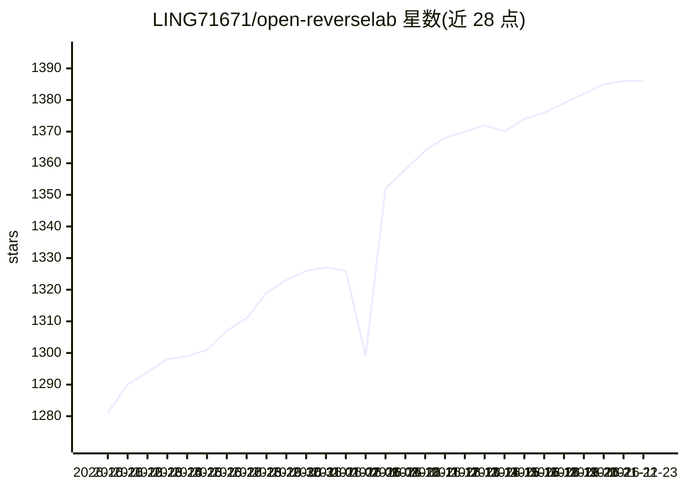

# LING71671/open-reverselab

⭐ 1,386 · Python · Apache-2.0 · 推送 2026-11-19 · [GitHub](https://github.com/LING71671/open-reverselab) · [官网](https://ling71671.github.io/open-reverselab/) · 个人维护 · 中文 README

**给逆向工程人员的 AI 工作区桌面应用**

面向目标驱动的逆向工程任务的 AI 桌面工作区：用户选定 red/blue/both 轨道，输入文件、目录或 URL 目标并下达 Goal，应用通过 OpenAI 兼容的 chat-completions 端点执行目标分诊、Python 动作与 MCP 工具（支持 Ghidra、Frida、x64dbg、Rizin），画布实时展示执行分支并保留日志、报告与健康视图。Windows x64 提供安装包与便携 ZIP；macOS/Linux 仅支持源码 CLI/MCP 流程。知识库（Web/CTF、Android/APK、Windows/PE 等）经 Git 子模块独立分发，需通过 Extensions 单独安装。

## 筛选速览

| 维度 | 判定 | 备注 |
|---|---|---|
| AI 角色 | `ai-native` | 本体是模型或模型工具 |
| 许可风险 | `permissive` | Apache-2.0 |
| 部署形态 | `desktop` | 安装包/桌面程序 |
| 模型依赖 | — | README 未给出锁定关系 |
| 硬件要求 | — | 无带数字的原话,不猜 |
| 安装摩擦 | `low` | 无编译、无系统依赖或容器化 |
| 成熟度 | `idea` | |

## 能力要点

- red/blue/both 三轨独立分析策略，both 模式支持证据交换与组合验证
- Goals 并发运行且默认无时间/token 限制
- MCP 工具接入 Ghidra、Frida、x64dbg、Rizin（stdio 与 Streamable HTTP）
- 知识库覆盖 Web/CTF、Android/APK、Windows/PE 与通用主题

## 适用场景

- 对 APK 或 PE 样本做目标驱动的逆向分析
- CTF 题目解题辅助与知识检索
- 红蓝两侧对照的安全分析与证据留存

## 场景标签

`网络安全` · 领域:学习与行业

## 证据(README 行号)

> L5: **An AI workspace for target-based reverse engineering**
> L37: 3. Open Settings and configure an OpenAI-compatible chat-completions endpoint and model, then enter a target and ob
> L41: The desktop executes target triage, Python actions, and tools discovered through configured MCP connections, withou

## 星数曲线

2026-10-21 1,281 → 2026-11-23 1,386（+105）

---
*卡片 v1 · prompt 1.4 · 生成 2026-11-23 · 置信度 mid · 依据 README sha `b1b9dd67db84` · [字段定义](../../DATASET.md)*
