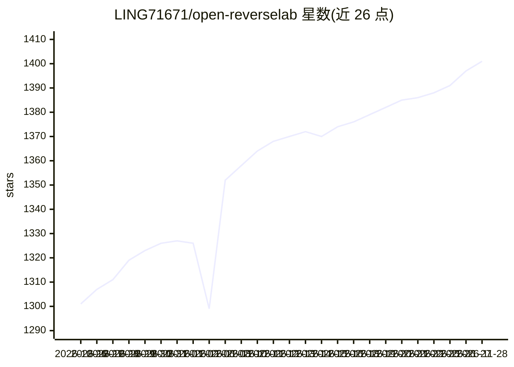

# LING71671/open-reverselab

⭐ 1,401 · Python · Apache-2.0 · 推送 2026-11-26 · [GitHub](https://github.com/LING71671/open-reverselab) · [官网](https://ling71671.github.io/open-reverselab/) · 个人维护

**面向逆向工程任务的 AI 工作台：桌面应用 + 知识库 + MCP 工具**

以目标驱动的 AI 逆向工程工作台：桌面端按 red/blue/both 三种分析策略选择，用户输入文件、目录或 URL 目标并下达 Goal，画布展示执行分支，活动、日志、报告视图留存证据。Goals 默认无时限与 token 限制，可并行运行。知识库覆盖 Web/CTF、Android/APK、Windows/PE 与通用主题，通过 Extensions 页安装知识包；MCP 连接支持 stdio 与 Streamable HTTP。桌面包需另行安装 Python、Ghidra、Frida、x64dbg 等外部工具，并在设置中配置 OpenAI 兼容端点；Windows x64 为桌面打包目标，macOS/Linux 走源码 CLI/MCP 流程。

## 筛选速览

| 维度 | 判定 | 备注 |
|---|---|---|
| AI 角色 | `ai-native` | 本体是模型或模型工具 |
| 许可风险 | `permissive` | Apache-2.0 |
| 部署形态 | `desktop` | 安装包/桌面程序 |
| 模型依赖 | — | README 未给出锁定关系 |
| 硬件要求 | — | 无带数字的原话,不猜 |
| 安装摩擦 | `low` | 无编译、无系统依赖或容器化 |
| 成熟度 | `idea` | |

## 能力要点

- red/blue/both 三策略独立分析与证据交叉验证机制
- Goals 并行运行且默认无时限/ token 限制
- 知识库覆盖 Web/CTF、Android/APK、Windows/PE 等领域，经 Extensions 安装
- MCP 工具对接 Ghidra、Frida、x64dbg、Rizin，支持 stdio 与 Streamable HTTP

## 适用场景

- 对样本或目标做红队/蓝队方向的 AI 辅助逆向分析
- CTF 比赛或安全学习中按知识库条目执行工具脚本
- 恶意软件分析的取证留存：日志、报告与执行历史

## 场景标签

`网络安全` · 领域:学习与行业

## 证据(README 行号)

> L5: **An AI workspace for target-based reverse engineering**
> L41: The desktop executes target triage, Python actions, and tools discovered through configured MCP connections, withou
> L49: The knowledge base covers Web/CTF, Android/APK, Windows/PE, and general topics such as cryptography and protocols. 

## 星数曲线

2026-10-26 1,301 → 2026-11-28 1,401（+100）

---
*卡片 v1 · prompt 1.4 · 生成 2026-11-27 · 置信度 high · 依据 README sha `50ea19061048` · [字段定义](../../DATASET.md)*
