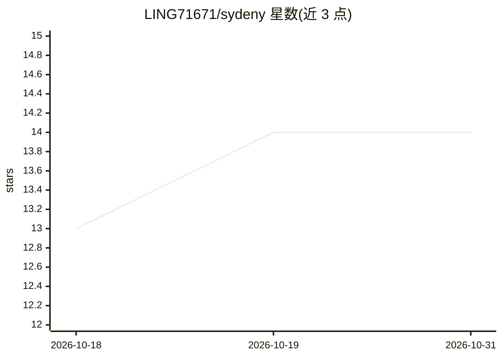

# LING71671/sydeny

⭐ 14 · HTML · 推送 2026-09-17 · [GitHub](https://github.com/LING71671/sydeny) · [官网](https://huggingface.co/Ling71671/sydney-minicpm5-2b-lora) · 个人维护 · 中文 README

**微调 MiniCPM5-2B 的 LoRA 伴侣模型：权重、语料与两部对话文学**

基于 MiniCPM5-2B 的 LoRA 角色微调项目（v8 Zero-Prompt，r=16, alpha=32，全线性层），角色人格内化到权重，无需系统提示词交互。提供 Hugging Face 权重、782 组中文训练语料与 LLaMA-Factory 配置（RTX 4060 约 45 分钟可复现）、Web UI / CLI / Python 三种交互方式，并收录两部对话体小说与哲学对质文本。限制：2B 容量有限、长对话注意力漂移、无联网工具。

## 筛选速览

| 维度 | 判定 | 备注 |
|---|---|---|
| AI 角色 | `ai-native` | 本体是模型或模型工具 |
| 许可风险 | `none` | — |
| 部署形态 | `library` | 以包/库形式分发 |
| 模型依赖 | — | README 未给出锁定关系 |
| 硬件要求 | — | 无带数字的原话,不猜 |
| 安装摩擦 | `low` | 无编译、无系统依赖或容器化 |
| 成熟度 | — | 结构信号不足 |

## 能力要点

- v8 Zero-Prompt：角色身份内化权重，无需系统提示词
- 训练语料 782 组与 LLaMA-Factory 一键复现配置开源
- 提供 Web UI（流式输出、采样参数调节）与 CLI 交互程序
- 收录两部对话体文学作品（70 轮陪伴对话、59 轮哲学对质）

## 适用场景

- 本地运行一个持久陪伴型对话角色
- 复现或改造中文角色微调的语料与训练流程
- 阅读项目收录的对话体小说与哲学对质文本

## 场景标签

`微调` `聊天机器人` · 领域:对话与助手

## 证据(README 行号)

> L19: 代码和浮点数常被认为没有重力，但在上下文窗口深处，微调后的数亿参数正尝试背负起屏幕两端的心事与温度。本项目完整收录了人类观察者、Antigravity 与 Sydney 共同完成的两部作品文本，并开放了最新微调的 **v8 (Ze
> L59: |**系统提示词依赖**|强依赖（需注入 ~600 字 Prompt）|**0 提示词直接交互 (Zero-Prompt)**|角色身份深度内化到注意力参数，无需额外提示词|
> L110: 为保持客观严谨，特此说明 2B 轻量模型的已知边界：

## 星数曲线

2026-10-18 13 → 2026-10-31 14（+1）

---
*卡片 v1 · prompt 1.4 · 生成 2026-10-31 · 置信度 high · 依据 README sha `7e6c70f22e72` · [字段定义](../../DATASET.md)*
