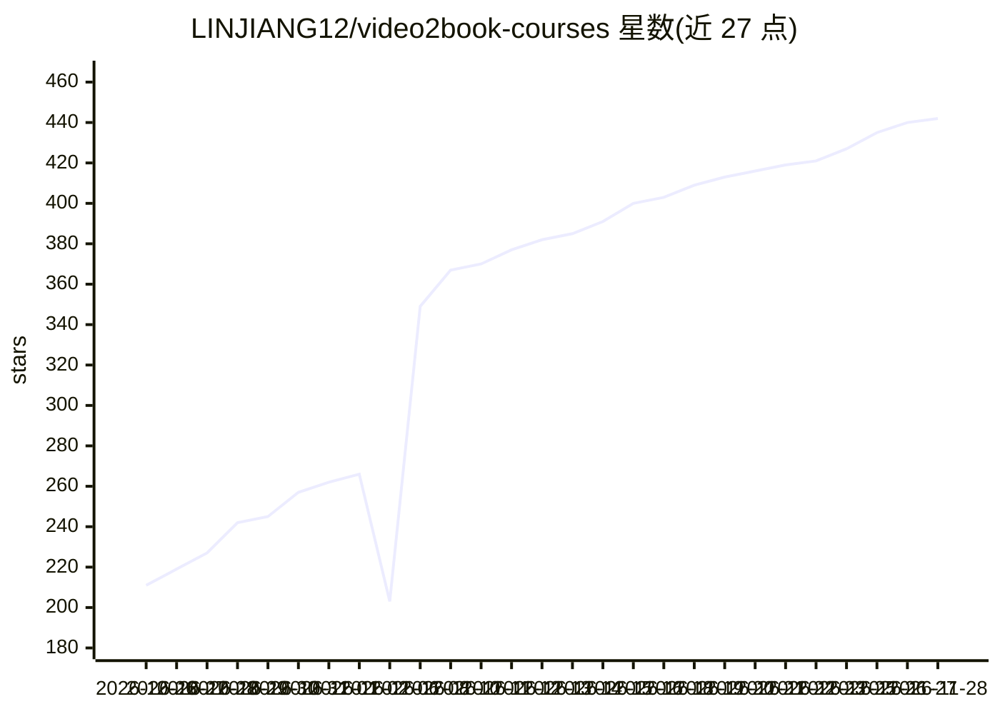

# LINJIANG12/video2book-courses

⭐ 442 · 推送 2026-11-16 · [GitHub](https://github.com/LINJIANG12/video2book-courses) · 个人维护 · 中文 README

**97 门网课的 AI 重构教材/笔记/逐字稿库，供学习复习**

内容仓库：收录 97 门真实网课经 Video2Book 从课程音频自动重构的三类产物——883 册模块合辑全书、1,226 篇复习笔记、4,691 份逐字稿，覆盖计算机、数学、法学、医学、经济等方向。笔记支持 Markmap/XMind 脑图导入，配套 GitHub Pages 在线阅读站。声明仅供个人学习使用、无 LICENSE 文件、不得商用或替代原课程。

## 筛选速览

| 维度 | 判定 | 备注 |
|---|---|---|
| AI 角色 | `ai-knowledge` | 知识聚合/清单类 |
| 许可风险 | `none` | — |
| 部署形态 | `None` |  |
| 模型依赖 | — | README 未给出锁定关系 |
| 硬件要求 | — | 无带数字的原话,不猜 |
| 安装摩擦 | `medium` | 含编译或系统依赖之一 |
| 成熟度 | — | 结构信号不足 |

## 能力要点

- 883 册模块全书、1,226 篇复习笔记、4,691 份逐字稿
- 三类产物按集号可互相追溯（PXX_ 前缀对应原分集）
- 笔记拓扑树支持 Markmap 插件与 XMind 大纲导入
- 配套 GitHub Pages 在线阅读站，KaTeX 公式渲染

## 适用场景

- 把看不完的长视频课变成可翻阅的教材
- 考前按复习笔记做知识盘点与速查
- 用逐字稿核对讲师原话并自编课程
- 导入 XMind/Markmap 生成脑图复习

## 场景标签

`教程课程` · 领域:学习与行业

## 证据(README 行号)

> L3: 九十七门真实网课的**模块合辑全书 + 思维导图复习笔记 + 逐字稿**，全部由 Video2Book 从课程音频重构而成。
> L260: 本仓库内容全部由 Video2Book 生成：

## 星数曲线

2026-10-26 211 → 2026-11-28 442（+231）

---
*卡片 v1 · prompt 1.4 · 生成 2026-11-25 · 置信度 high · 依据 README sha `7b42f7e63557` · [字段定义](../../DATASET.md)*
