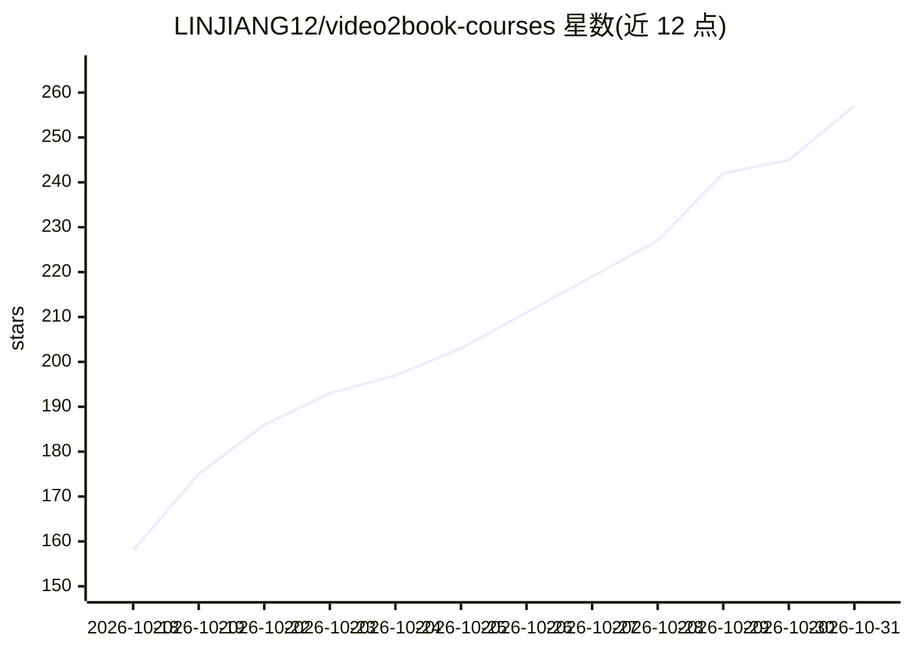

# LINJIANG12/video2book-courses

⭐ 257 · 推送 2026-10-29 · [GitHub](https://github.com/LINJIANG12/video2book-courses) · 个人维护 · 中文 README

**AI 生成的网课精读教材/笔记/逐字稿合集，供学习复习**

内容型仓库：由 Video2Book 流水线从真实网课音频重构出 518 册模块合辑教材、603 篇思维导图复习笔记与 2,286 份逐字稿，覆盖计算机、数学、考研、考公、法学、医学、哲学等 61 门课程。生成流程为 ffmpeg 提取音频切片→逐集精读长文→按知识体系整编为教材与笔记，交付前经机器门禁拦截套话与空壳标题。笔记可用 Markmap/XMind 导入脑图，另配 GitHub Pages 在线阅读站。仓库无 LICENSE，仅供个人学习，禁止商用。

## 筛选速览

| 维度 | 判定 | 备注 |
|---|---|---|
| AI 角色 | `ai-knowledge` | 知识聚合/清单类 |
| 许可风险 | `none` | — |
| 部署形态 | `None` |  |
| 模型依赖 | — | README 未给出锁定关系 |
| 硬件要求 | — | 无带数字的原话,不猜 |
| 安装摩擦 | `medium` | 含编译或系统依赖之一 |
| 成熟度 | — | 结构信号不足 |

## 能力要点

- 518 册模块合辑教材 + 603 篇复习笔记 + 2,286 份逐字稿，覆盖 61 门课程
- 笔记知识拓扑树支持 Markmap / XMind 脑图导入
- 配套 GitHub Pages 在线阅读站，KaTeX 公式渲染与标题自动编号
- 逐字稿要求真正处理过本集音频，含机器门禁质检环节

## 适用场景

- 把看不完的长视频课变成可随时翻阅的教材来精读
- 考前用思维导图笔记做知识速查与盘点
- 通过逐字稿核对讲师原话

## 场景标签

`教程课程` · 领域:学习与行业

## 证据(README 行号)

> L3: 六十一门真实网课的**模块合辑全书 + 思维导图复习笔记 + 逐字稿**，全部由 Video2Book 从课程音频重构而成。
> L190: 本仓库内容全部由 Video2Book 生成：
> L193: 2. 逐集处理音频，按统一风格提示词写成单集精读长文（**中间产物，不随本仓库发布**）

## 星数曲线

2026-10-18 158 → 2026-10-31 257（+99）

---
*卡片 v1 · prompt 1.4 · 生成 2026-10-22 · 置信度 high · 依据 README sha `ad91f99540b4` · [字段定义](../../DATASET.md)*
