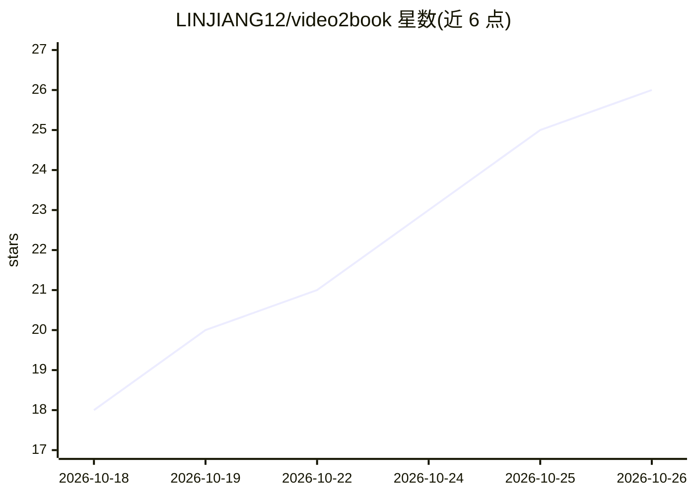

# LINJIANG12/video2book

⭐ 26 · Python · MIT · 推送 2026-10-11 · [GitHub](https://github.com/LINJIANG12/video2book) · 个人维护 · 中文 README

**把 B 站/YouTube 等长视频课程转为教材长文与复习笔记的 Agent 技能**

面向 AI 编程助手（Claude Code/Codex/OpenCode 宿主）的技能：接受 B 站合集、YouTube、抖音或本地课程目录，按元数据切分为 40–60 分钟知识块，字幕优先取块级逐字稿（缺字幕块才经 MCP 听音通道转录），一块产出一篇模块精读长文，再整编为模块教材与思维导图复习笔记，交付前经机器门禁拦截套话填充等问题。Python 3.10+，需 ffmpeg；B 站抓取建议配置 SESSDATA，凭证明文落盘但不进版本库。

## 筛选速览

| 维度 | 判定 | 备注 |
|---|---|---|
| AI 角色 | `ai-native` | 本体是模型或模型工具 |
| 许可风险 | `permissive` | MIT |
| 部署形态 | `library` | 以包/库形式分发 |
| 模型依赖 | locked-api |  |
| 硬件要求 | — | 无带数字的原话,不猜 |
| 安装摩擦 | `medium` | 含编译或系统依赖之一 |
| 成熟度 | — | 结构信号不足 |

## 能力要点

- 按分集时长切块、字幕优先、缺块才听音的两阶段流水线
- 三轨交付：模块精读长文、模块合辑教材、跨块复习笔记
- 交付前机器门禁拦截套话填充、空壳标题等五类致命项
- 四条件全过时自动回收中间音频产物

## 适用场景

- 把 B 站网课合集转成可精读的教材长文
- 备考时生成思维导图式复习笔记
- 将本地课程音视频整理为结构化学习资料

## 场景标签

`AI 写作` · 领域:内容生成

## 证据(README 行号)

> L30: Video2Book 是一个面向 AI 编程助手的技能，用来把一门课写成教材。它接受 B 站合集、YouTube 频道/播放列表、抖音合集或本地课程目录，一块产出**一篇**模块精读长文（块覆盖连续的几集），再把各块长文整编为模块
> L32: 长课程的直接难点是听不完、也记不住。这个技能先由课程元数据（集号与时长）把课程切成 40–60 分钟的知识块（超长集劈上下），块计划落在工作区根目录 `block_plan.json`，**规划阶段不下载任何音频**；块级逐字稿优

## 星数曲线

2026-10-18 18 → 2026-10-26 26（+8）

---
*卡片 v1 · prompt 1.4 · 生成 2026-10-26 · 置信度 high · 依据 README sha `0ba7974d5643` · [字段定义](../../DATASET.md)*
