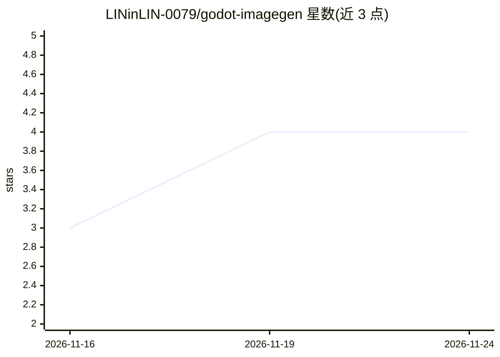

# LINinLIN-0079/godot-imagegen

⭐ 4 · JavaScript · MIT · 推送 2026-10-10 · [GitHub](https://github.com/LINinLIN-0079/godot-imagegen) · 个人维护 · 中文 README

**把本机 SD WebUI/ComfyUI 接进对话出图的 DSH 插件**

面向 Godot 游戏开发者的 DeepSeek Harness 插件：注册 10 个 image_* 工具，让代理在对话里调用本机秋叶整合包的 SD WebUI（:7860，默认后端）与 ComfyUI（:8188）完成文生图、图生图、放大、抠图、反推提示词；产物写入 Godot 项目的 assets/generated/ 并生成 res:// 路径。面板内嵌真实 ComfyUI 前端画布，通过随插件分发的 web 扩展（postMessage 桥接）实现对话直接改写画布；ComfyUI 通道仅实现文生图/图生图，ControlNet、放大、反推需走 SD WebUI。

## 筛选速览

| 维度 | 判定 | 备注 |
|---|---|---|
| AI 角色 | `ai-native` | 本体是模型或模型工具 |
| 许可风险 | `permissive` | MIT |
| 部署形态 | `None` |  |
| 模型依赖 | locked-api |  |
| 硬件要求 | — | 无带数字的原话,不猜 |
| 安装摩擦 | `low` | 无编译、无系统依赖或容器化 |
| 成熟度 | — | 结构信号不足 |

## 能力要点

- 10 个 image_* 工具：生成、编辑、变体、放大、抠图、反推等
- 内嵌真实 ComfyUI 画布，对话可改写并推送工作流
- 产物落 assets/generated/ 并给出 res:// 路径注册进资产库
- 桥接安装可逆：写入前备份、卸载按清单零残留

## 适用场景

- 在对话里为 Godot 项目生成角色、UI、贴图等美术资产
- 用 ComfyUI 工作流模板批量产出游戏图标并自动归档
- 对话直接驱动 ComfyUI 画布编辑节点后出图

## 场景标签

`图像生成` · 领域:内容生成

## 证据(README 行号)

> L3: **本地 AI 出图 → Godot 可用美术资产** 的 DSH 插件。
> L18: |模型工具（10）|`image_backend_status` `image_generate` `image_edit` `image_variants` `image_upscale` `image_cutout` `ima

## 星数曲线

2026-11-16 3 → 2026-11-24 4（+1）

---
*卡片 v1 · prompt 1.4 · 生成 2026-11-21 · 置信度 high · 依据 README sha `fe6726496f97` · [字段定义](../../DATASET.md)*
