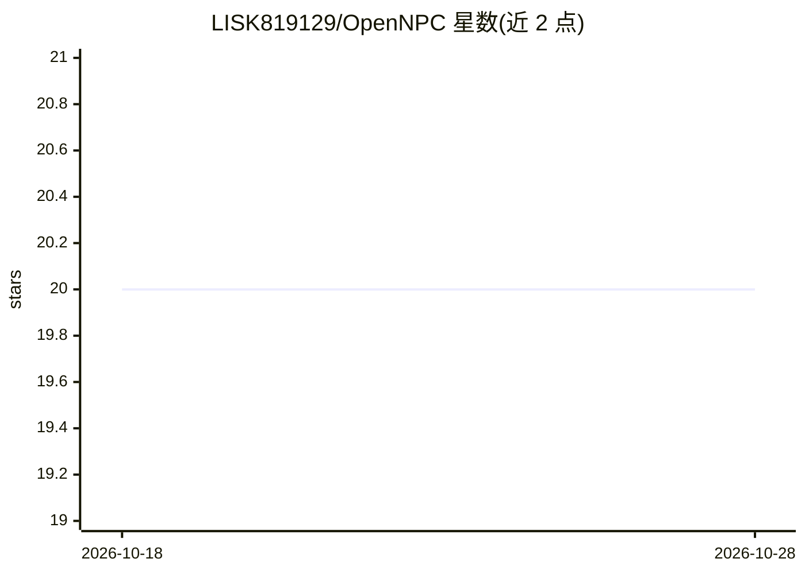

# LISK819129/OpenNPC

⭐ 20 · C# · NOASSERTION · 推送 2026-09-21 · [GitHub](https://github.com/LISK819129/OpenNPC) · [官网](https://lisk819129.github.io/OpenNPC/) · 个人维护

**给游戏开发者的性格驱动 NPC 对话 AI 框架**

开源 NPC 对话框架：以 JSON persona 文件（性格、背景、知识、记忆）驱动 LLM 生成角色内回复。后端为引擎无关的 HTTP 服务器，跑 Qwen2.5-0.5B-Instruct 的 LoRA 微调版（GGUF 4bit，llama.cpp/Vulkan，GTX 1650 Ti 约 0.14s/回复），可接入 Unity/Godot/Unreal 或网页；仓库附带 Unity 6000.6 演示。另提供无需模型的离线 mock provider，以及可对接 Ollama/LM Studio/vLLM 的 Node stub。状态自述为早期（early）。

## 筛选速览

| 维度 | 判定 | 备注 |
|---|---|---|
| AI 角色 | `ai-ecosystem` | LLM/agent 周边工具 |
| 许可风险 | `none` | NOASSERTION |
| 部署形态 | `None` |  |
| 模型依赖 | local-ok | 支持本地模型 |
| 硬件要求 | — | 无带数字的原话,不猜 |
| 安装摩擦 | `low` | 无编译、无系统依赖或容器化 |
| 成熟度 | `idea` | |

## 能力要点

- persona JSON schema 定义 NPC 性格/知识/记忆，PersonaGenerator 确定性生成其余 NPC
- Qwen2.5-0.5B LoRA 微调 + GGUF 4bit + llama.cpp/Vulkan，约 0.14s/回复（GTX 1650 Ti）
- 引擎无关 HTTP 契约，附带 Unity 6000.6 参考实现与 WebGL 网页演示
- 离线 mock provider 零模型可用；Node stub 可接 Ollama/LM Studio/vLLM

## 适用场景

- 为 Unity/Godot/Unreal 游戏接入性格化 NPC 对话
- 不想跑模型时用离线 mock 快速验证 persona 效果
- 用自有本地模型服务替换默认后端

## 场景标签

 · 领域:游戏开发/AI 框架

## 证据(README 行号)

> L13: OpenNPC is an open-source framework for NPCs whose conversations are driven by
> L18: The backend is engine-agnostic. It's a small HTTP server that takes a persona and a
> L110: `OpenNPCDialogueProvider` is an HTTP client for the documented contract. It talks to

## 星数曲线

2026-10-18 20 → 2026-10-28 20（+0）

---
*卡片 v1 · prompt 1.4 · 生成 2026-10-28 · 置信度 high · 依据 README sha `197d7987e1dc` · [字段定义](../../DATASET.md)*
