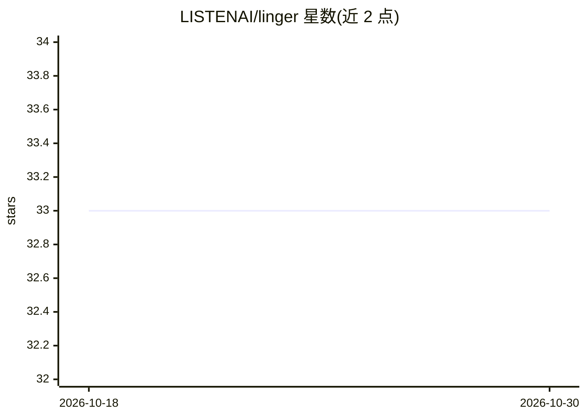

# LISTENAI/linger

⭐ 33 · Python · Apache-2.0 · 推送 2026-08-07 · [GitHub](https://github.com/LISTENAI/linger) · 组织维护 · 中文 README

**基于 PyTorch 的聆思 IoT 芯片 8bit 量化训练工具**

面向聆思（LISTENAI）IoT 系列芯片的神经网络量化训练库：基于 PyTorch 在前向过程中将激活和权重量化到 8bit，通过参数调整获得量化无损的 8bit 模型，并可导出为 ONNX 格式。用法是在浮点训练代码中加入一行 linger 代码替换量化算子，沿用原训练流程；支持添加符合 PyTorch 拓展规范的量化算子。支持 pip、源码、docker 三种安装方式，文档覆盖混合精度量化、TQT 量化训练与局部调优。

## 筛选速览

| 维度 | 判定 | 备注 |
|---|---|---|
| AI 角色 | `ai-ecosystem` | LLM/agent 周边工具 |
| 许可风险 | `permissive` | Apache-2.0 |
| 部署形态 | `None` |  |
| 模型依赖 | — | README 未给出锁定关系 |
| 硬件要求 | — | 无带数字的原话,不猜 |
| 安装摩擦 | `low` | 无编译、无系统依赖或容器化 |
| 成熟度 | — | 结构信号不足 |

## 能力要点

- 前向过程中将激活和权重量化到 8bit，获得量化无损模型
- 浮点训练代码加入一行代码即可替换为量化算子
- 支持自定义 PyTorch 拓展量化算子
- 量化模型可导出为 ONNX 格式

## 适用场景

- 为聆思 IoT 芯片训练量化友好的 8bit 神经网络模型
- 在既有 PyTorch 训练流程中做量化训练微调
- 导出 ONNX 量化模型用于部署

## 场景标签

`模型量化` · 领域:训练与推理

## 证据(README 行号)

> L5: linger基于PyTorch对聆思IOT系列芯片进行深度定制，在神经网络训练的前向过程中将激活和权重量化到8bit，通过参数调整得到量化无损的8bit模型
> L11: linger 是基于 PyTorch 的量化方案，在原始浮点训练代码中加入一行 linger 相关代码即可完成进行量化算子的替换，使用原始的训练流程即可完成量化训练，无需其他复杂设置

## 星数曲线

2026-10-18 33 → 2026-10-30 33（+0）

---
*卡片 v1 · prompt 1.4 · 生成 2026-10-25 · 置信度 high · 依据 README sha `58bb4859e53e` · [字段定义](../../DATASET.md)*
