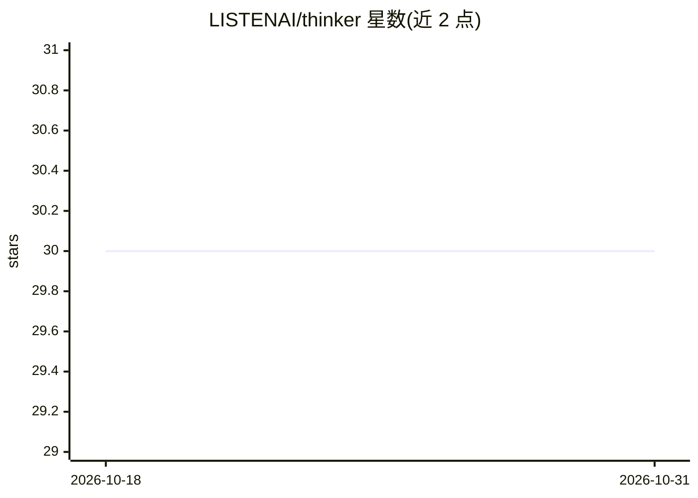

# LISTENAI/thinker

⭐ 30 · C · Apache-2.0 · 推送 2026-08-21 · [GitHub](https://github.com/LISTENAI/thinker) · 组织维护 · 中文 README

**面向聆思端侧芯片的轻量级神经网络推理框架与配套工具集**

聆思科技开发的轻量级神经网络推理框架，作为 LNN 通用推理引擎及工具集，与量化训练工具 Linger 配合，覆盖模型量化、图优化、资源打包、仿真验证、性能评估到端侧推理部署的完整链路。执行器为纯 C 实现、静态内存管理、无第三方运行时依赖；通过编译期配置适配 VENUS、ARCS、VENUSA 等目标平台，x86/Linux 侧用于仿真验证。支持 CV、NLP、ASR 模型与 ONNX 算子，芯片部署需向厂商 FAE 获取基础 SDK 工程。

## 筛选速览

| 维度 | 判定 | 备注 |
|---|---|---|
| AI 角色 | `ai-ecosystem` | LLM/agent 周边工具 |
| 许可风险 | `permissive` | Apache-2.0 |
| 部署形态 | `None` |  |
| 模型依赖 | — | README 未给出锁定关系 |
| 硬件要求 | — | 无带数字的原话,不猜 |
| 安装摩擦 | `low` | 无编译、无系统依赖或容器化 |
| 成熟度 | — | 结构信号不足 |

## 能力要点

- 离线工具链（tpacker）完成图优化、内存分析与资源序列化
- 纯 C 执行器、静态内存池、无第三方运行时依赖
- 通过 DTHINKER_TARGET_PLATFORM 编译期配置适配 VENUS/ARCS/VENUSA 平台
- tvalidator 结果验证与 tprofile 性能评估工具

## 适用场景

- 将 CV/ASR/NLP 模型量化并部署到聆思端侧芯片
- 在 x86/Linux 上仿真验证模型在目标芯片上的行为与精度
- 对齐训练端、仿真端与芯片端的推理结果

## 场景标签

`推理引擎` `模型量化` · 领域:训练与推理

## 证据(README 行号)

> L7: Thinker 是聆思科技开发的轻量级神经网络推理框架，也是 LNN 的通用推理引擎及配套工具集。它与量化训练工具 Linger 配合使用，覆盖从模型量化、图优化、设备适配、性能评估、结果验证到端侧推理部署的完整链路，帮助 CV、A
> L14: - **轻量运行时**：执行器采用纯 C 实现，静态内存管理，无第三方运行时依赖。
> L15: - **硬件适配**：通过 `DTHINKER_TARGET_PLATFORM` 和相关编译选项适配 VENUS、ARCS、VENUSA 等目标平台；x86/Linux 侧运行主要用于目标平台仿真验证，Thinker 上层代码与真

## 星数曲线

2026-10-18 30 → 2026-10-31 30（+0）

---
*卡片 v1 · prompt 1.4 · 生成 2026-10-26 · 置信度 high · 依据 README sha `9138a60bbdba` · [字段定义](../../DATASET.md)*
