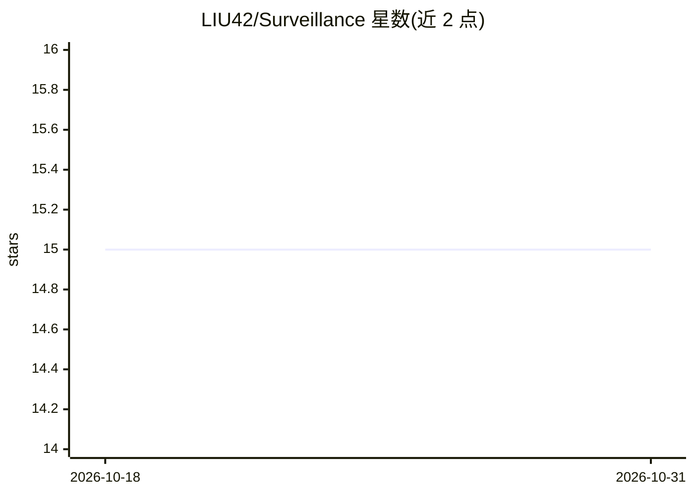

# LIU42/Surveillance

⭐ 15 · Vue · 推送 2026-08-24 · [GitHub](https://github.com/LIU42/Surveillance) · 个人维护 · 中文 README

**面向监控视频的视频异常行为检测系统（模型+前后端）**

基于片段级标签的视频异常检测方法及配套检测系统。模型将视频切分为16帧片段，用预训练 SlowFast 提取特征，经可学习相对位置编码的注意力模块做全局/局部上下文建模，再由时序卷积分类器输出片段异常得分，并对得分序列做平滑抑制噪声。训练将检测视为时间分割任务，使用 BCE+改进 Dice 组合损失，在重划分的 ShanghaiTech 数据集上训练。系统侧：ONNX Runtime 部署推理，MongoDB 持久化，Flask 服务端，Vue3/Element-Plus 客户端经 Nginx 反向代理，支持已有视频离线检测与视频流实时检测，异常得分超阈值时报警。

## 筛选速览

| 维度 | 判定 | 备注 |
|---|---|---|
| AI 角色 | `ai-native` | 本体是模型或模型工具 |
| 许可风险 | `none` | — |
| 部署形态 | `library` | 以包/库形式分发 |
| 模型依赖 | — | README 未给出锁定关系 |
| 硬件要求 | — | 无带数字的原话,不猜 |
| 安装摩擦 | `low` | 无编译、无系统依赖或容器化 |
| 成熟度 | — | 结构信号不足 |

## 能力要点

- 全局+局部注意力融合的片段级异常检测，附得分平滑策略
- 支持已有视频离线检测与实时视频流检测两种模式
- ShanghaiTech 上 AUC 97.49% / AP 74.35%
- Flask + MongoDB + Vue3/Element-Plus + Nginx 完整前后端系统，ONNX Runtime 部署

## 适用场景

- 对已有监控视频批量做异常行为检测
- 对监控视频流做实时异常检测并报警
- 基于该模型结构与训练方案做视频异常检测研究

## 场景标签

 · 领域:计算机视觉/视频监控

## 证据(README 行号)

> L7: 本项目基于对现有研究方法的改进和集成，构建了一种使用片段级标签的视频异常检测方法，同时在此基础上构建了一套面向监控视频的异常行为检测系统，实现了针对已有监控视频的异常检测和针对监控视频流的实时检测功能。
> L11: 本项目的模型结构主要参考了 这篇论文。首先将原始视频分割成 16 帧彼此不重叠的片段，使用预训练的 SlowFast 网络提取特征，随后将提取的特征序列降维后输入注意力模块进行上下文建模，最后输入时序卷积分类器模块得到每个片段的异

## 星数曲线

2026-10-18 15 → 2026-10-31 15（+0）

---
*卡片 v1 · prompt 1.4 · 生成 2026-10-30 · 置信度 mid · 依据 README sha `14fd2b570841` · [字段定义](../../DATASET.md)*
