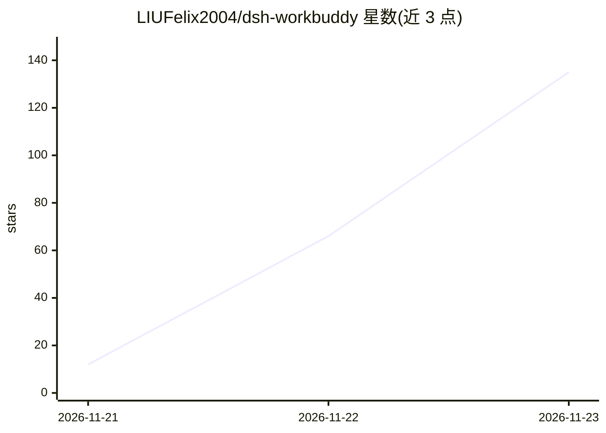

# LIUFelix2004/dsh-workbuddy

⭐ 135 · JavaScript · MIT · 推送 2026-11-21 · [GitHub](https://github.com/LIUFelix2004/dsh-workbuddy) · 个人维护 · 中文 README

**把 WorkBuddy 账号导入 DeepSeek Harness 作为模型 provider 的插件**

DeepSeek Harness（DSH）插件，读取 WorkBuddy 账号凭据后在 llm-pi-ai 中为每个账号写入独立 provider 路由，使账号内全部模型出现在 DSH 模型选择器中；提供积分余额查询面板、按账号独立计数的额度路由，并在 fetch 层安装守卫改写 system 文本与 User-Agent 以绕过网关 11128 渠道校验。模型目录读本机 WorkBuddy 产品配置，无该配置时退回 25 个内置模型。要求 DSH ≥0.2.1 与 Node.js ≥18。

## 筛选速览

| 维度 | 判定 | 备注 |
|---|---|---|
| AI 角色 | `ai-ecosystem` | LLM/agent 周边工具 |
| 许可风险 | `permissive` | MIT |
| 部署形态 | `None` |  |
| 模型依赖 | — | README 未给出锁定关系 |
| 硬件要求 | — | 无带数字的原话,不猜 |
| 安装摩擦 | `low` | 无编译、无系统依赖或容器化 |
| 成熟度 | — | 结构信号不足 |

## 能力要点

- 一个账号一条独立 provider 路由（wb-xxxxxxxx），额度与限流各自计算
- 每账号显示积分余额、套餐名、用量进度条与分类明细
- fetch 守卫自动修正触发网关 11128 的 system 文本与 User-Agent
- 模型目录从本机 WorkBuddy 产品配置读取，与客户端一致

## 适用场景

- 在 DeepSeek Harness 中用 WorkBuddy 账号调用其模型列表
- 同时管理多个 WorkBuddy 账号的额度并按路由独立计数
- 绕过 WorkBuddy 网关的 11128 渠道拦截问题

## 场景标签

`模型网关` · 领域:Agent 开发

## 证据(README 行号)

> L3: > 把 **WorkBuddy 账号**接进 **DeepSeek Harness**：一个账号一条 provider 路由，WorkBuddy 里的全部模型直接出现在 DSH 的模型选择器里，并显示每个账号的积分余额、自动绕过网关
> L36: 要求：DeepSeek Harness `0.2.1` 或更高（web / desktop 均可），Node.js `>= 18`。
> L71:  - 在 `llm-pi-ai` 里写入 provider `WorkBuddy · 账号名`；

## 星数曲线

2026-11-21 12 → 2026-11-23 135（+123）

---
*卡片 v1 · prompt 1.4 · 生成 2026-11-21 · 置信度 high · 依据 README sha `d43fd4e20f29` · [字段定义](../../DATASET.md)*
